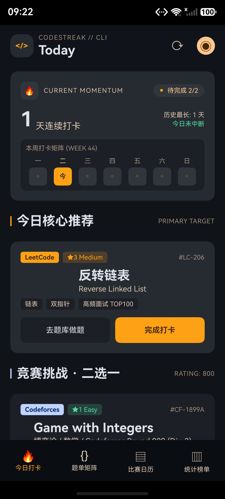

# CodeStreak

> 把刷题变成不可断的连胜。跨平台刷题打卡 + 赛训一体化 HarmonyOS 应用。

本仓库按 [`docs/`](docs/README.md) 中的设计文档实现。当前处于 **v1.0.0-rc.1（发布前自测完成、待签名提审）**：四页闭环、RDB 持久化、五平台同步、真实统计与赛程均已落地，90 条单测全绿；发布门禁与阻塞项见 [发布前自测报告](docs/07-测试与质量/04-发布前自测报告.md)。



**CodeStreak** 把跨平台刷题变成一条不断裂的连胜：今日打卡、题单矩阵（求职 / 竞赛双赛道）、比赛日历（ICPC/CCPC + CF + AtCoder 真实赛程）、统计榜单，数据本地优先，支持 Codeforces / AtCoder / 洛谷 / 牛客 / LeetCode 同步。

## 快速开始

### 方式一：DevEco Studio（推荐）

1. 用 DevEco Studio 打开仓库根目录（`File → Open`）。
2. 等待 `ohpm install` 与 hvigor 同步完成（首次可能需要网络下载依赖）。
3. 选择 `entry` 模块，连接真机或启动模拟器，点击 Run。
4. 当前无签名配置，真机安装需在 `File → Project Structure → Signing Configs` 中自动签名。

### 方式二：命令行构建（本机已验证）

```powershell
$env:DEVECO_SDK_HOME = 'D:\develop\harmony\DevEco Studio\sdk'
$node   = 'D:\develop\harmony\DevEco Studio\tools\node\node.exe'
$hvigor = 'D:\develop\harmony\DevEco Studio\tools\hvigor\bin\hvigorw.js'

& $node $hvigor --no-daemon assembleHap -p product=default -p buildMode=debug
```

产物：`entry/build/default/outputs/default/entry-default-unsigned.hap`（约 1.23 MB，未签名）。

> Windows 上若构建报 `EPERM: .hvigor\outputs\build-logs\build.log`，说明当前终端身份对该目录无写权限，需在可写环境（DevEco 终端或提权终端）执行。

## 当前实现范围

| 模块 | 状态 | 说明 |
| --- | --- | --- |
| 设计令牌 | ✅ | `constants/DesignTokens.ets` 与 `docs/02-设计规范/02` 一致（颜色/间距/圆角/字号） |
| 数据模型 | ✅ | 枚举 + 实体接口（`model/`），字段对齐 `docs/04-技术设计/03` |
| 种子数据 | ✅ | `data/SeedData.ets` 仅保留题目/题单目录与文案；用户统计一律来自本地库，空即为空 |
| P-01 今日打卡 | ✅ | 连续打卡主卡、周矩阵、核心推荐与竞赛挑战、打卡链路、庆祝弹层 |
| P-03 比赛日历 | ✅ | ICPC/CCPC + CF + AtCoder 真实赛程、周条、筛选；补题与倒计时在无数据时为空态 |
| P-04 统计榜单 | ✅ | 用户卡、真实热力图/难度分布/徽章；好友榜无数据源时为空态 |
| 全局框架 | ✅ | AppBar + 四 Tab（保留各页状态）、Toast、打卡庆祝遮罩 |
| RDB 持久化 | ✅ | `data/db`（v2）：7 张表（user / check_in / problem / contest / app_setting / submission / sync_job）、首启种子灌库、打卡与提交落库、当日 AC 聚合 |
| P-02 题单矩阵 | ✅ | 求职/竞赛双赛道分离、题单卡跳官方页、搜索/难度/平台多选（实心选中态）、题目行跳转 |
| 单元测试 | ✅ | hypium 本地单测 **90 条全通过**（难度/日期/打卡/映射/同步策略/热力图/提醒/重试/统计/赛程/赛道/题单进度），行覆盖 87.71%、分支 73.44% |
| 平台同步 | 🟡 | **五平台（CF / AtCoder / 洛谷 / LeetCode / 牛客）**：节流 → HTTP/GraphQL/HTML → 映射 → 幂等落库；登录态经内置 WebView 获取 |
| 登录授权 | ✅ | 内置 [WebLogin](entry/src/main/ets/pages/WebLogin.ets)：洛谷 / 牛客 / LC 登录后抓取 Cookie，再执行导入 |
| 应用图标 | ✅ | 自绘分层图标（深色网格底 + 琥珀火焰 + 勾 + 翡翠光点）与启动图标，已打入 HAP |
| 发布准备 | 🟡 | 隐私与权限说明、发布前自测报告、商店截图与流程 GIF 已完成；**签名证书与主体信息待补** |
| 赛事与外链 | ✅ | ICPC/CCPC（[CPC Finder](https://cpcfinder.com/contest)）+ Codeforces + AtCoder 真实赛程；题目与赛事按钮跳转系统浏览器 |
| 数据可视化 | ✅ | 热力图、难度分布、连续天数、总 AC 全部按本地记录计算；无数据显示 0 或空态 |
| 通知提醒 | 🟡 | 每日 21:30 通过 `reminderAgentManager` 发布代理提醒，设置开关联动；待真机验证送达 |

## 目录结构

```text
entry/src/main/ets/
├── entryability/          EntryAbility（强制暗色 + 加载 pages/Index）
├── pages/Index.ets        主壳：AppBar + Tabs + 绑定弹层 + Toast + 启动装载
├── pages/WebLogin.ets     内置登录页（洛谷 / 牛客 / LC），登录后抓取并保存 Cookie
├── views/                 四个一级页（Today / Matrix / Contest / Stats）
├── components/
│   ├── Common.ets         C-01 AppBar、C-03 区块标题、C-08 指标块、C-13/C-14 徽标、C-15 进度条、空态
│   ├── Cards.ets          C-04 连续打卡卡（hero/hud）、C-06/C-07 目标卡、C-26 倒计时、C-27 补题率、C-29 比赛卡、C-30 补题卡、C-31 用户卡、C-36 设置行
│   └── Visuals.ets        C-28 周条、C-32 热力图、C-33 难度分布、C-34 徽章、C-35 排行榜、C-40 骨架、今日战报
├── domain/                CheckInService、SyncPolicy、ReminderPlan、RetryQueue、StatsService、TrackFilter、CollectionProgress
├── model/                 Enums、Entities、SyncModels、ContestFeed
├── data/
│   ├── SeedData.ets       自洽数据集 v1
│   ├── SyncService.ets    同步编排（拉取 → 落库 → 当日 AC → sync_job → 重试）
│   ├── CredentialStore.ets 登录 Cookie 存取（洛谷 / 牛客 / LC）
│   ├── ContestFeedService.ets  ICPC/CCPC 赛程（CPC Finder → 比赛卡）
│   ├── NotificationService.ets 每日 21:30 代理提醒（reminderAgentManager）
│   ├── db/                DbSchema（DDL v2）、DatabaseHelper（初始化/种子/读写/聚合/设置）
│   └── remote/            Codeforces / AtCoder / Luogu / LeetCode / NowCoder / Cpcfinder 适配器与映射
├── constants/             DesignTokens、AppConfig（Tab 配置与图标字符）
└── utils/                 DateUtil、Difficulty、Heatmap、LinkService

entry/src/test/            hypium 单测：难度/日期/打卡/五类映射/同步策略/热力图/提醒/重试/统计/赛程/牛客解析
```

## 测试

```powershell
$env:DEVECO_SDK_HOME = 'D:\develop\harmony\DevEco Studio\sdk'
& 'D:\develop\harmony\DevEco Studio\tools\node\node.exe' `
  'D:\develop\harmony\DevEco Studio\tools\hvigor\bin\hvigorw.js' `
  --no-daemon test -p product=default
```

报告：`entry/.test/default/intermediates/test/coverage_data/test_result.txt`（逐条用例）与
`entry/.test/default/outputs/test/reports/index.html`（覆盖率）。

## 已知限制

1. **同步覆盖五个平台**：设置 →「OJ 元数据同步管理」可绑定 CF / AtCoder / 洛谷 / LeetCode / 牛客；洛谷、LC、牛客需先点「登录获取授权」在内置 WebView 完成登录。
2. **登录 Cookie 目前明文存储**：三个平台的 Cookie 存在 `app_setting`，上架前需迁入 Asset Store 并做失效清理。
3. **牛客导入依赖页面结构**：登录后解析练习页 `/acm/problem/{id}` 链接，页面改版会导致解析失败；牛客无提交时间，导入记为导入时刻。
4. **LC 难度为兜底值**：最近 AC 不含难度，统一按 ★3 计，后续按 titleSlug 补元数据。
5. **重试仅在启动时消费**：失败会落一条重试记录并按 1/5/15 分钟退避，应用不重启则不会自动重试；无后台常驻调度。
6. **AtCoder 难度为估算值**：按题位字母映射（A→★1 … G→★5），未接 `problem-models.json`。
7. **赛事覆盖 ICPC/CCPC + CF + AtCoder**：LC/洛谷赛程需登录态，对应筛选为空态；不再展示示例赛事。
8. **好友榜 / 题单订阅 / 补题为空态**：无对应数据源，页面显示「暂无」；题单卡可跳官方页，但没有成员清单，暂不显示完成度（避免假进度）。
9. **外链跳转依赖系统浏览器**：题目/赛事按钮通过 `viewData` 打开链接，设备无浏览器或链接失效时会提示失败。
10. **提醒依赖系统授权**：首次开启会弹通知授权；拒绝后开关回退并提示，未做独立权限引导页。
11. **应用图标为工程首版**：火焰 + 勾 + 网格底，待品牌视觉确认后可替换 `background/foreground.png`。
12. **应用内图标仍为字符占位**（✓ ★ 🔥 →），待替换 `SymbolGlyph` 或字体图标。
13. **真机回归范围有限**：90 条单测、构建、首页/题单/赛程/统计走查与重启持久化已通过；WebView 登录、AtCoder/洛谷/LC/牛客导入、提醒送达尚未逐条回归（对照 [自测报告](docs/07-测试与质量/04-发布前自测报告.md)）。
14. **签名与主体信息缺失**：无签名证书、隐私声明主体/邮箱为占位，暂不能提审。
15. **隐私声明主体待填**：见 [隐私与权限说明](docs/06-附录/02-隐私与权限说明.md) §7。

## 版本管理

仓库已按 [Git版本管理规范](docs/05-项目规范/05-Git版本管理规范.md) 纳管：

- 分支：`main`（发布）/ `develop`（集成）/ `feature/*`、`fix/*`、`docs/*`、`chore/*`（短生命周期）；
- 远端：[github.com/acm910/codestreak](https://github.com/acm910/codestreak)（公开；默认分支 `main`；SSH 走 443）；
- 提交：Conventional Commits，`<type>(<scope>): <简述>`，一事一提交；
- 版本：SemVer + 注释标签 `vX.Y.Z`，`versionCode = 主*1000000 + 次*1000 + 修订`；
- 每次任务完成必须同步更新 [实现进度与代码映射](docs/04-技术设计/08-实现进度与代码映射.md)。

## AI Skill（开发流程复用）

把本项目的交付流程沉淀为可复用 skill：[`skills/harmony-arkts-delivery`](skills/harmony-arkts-delivery/SKILL.md)。

- 内容：文档先行、真实数据、构建/单测、HDC 真机验证与截图、发布准备（分层图标/隐私/自测/RC 标签）、MD+Word 报告生成；
- 脚本：`harmony-build.ps1`（自动定位 SDK 并跑 hvigor）、`hdc-verify.ps1`（截图/点击/重启）；
- 安装（DSH + Claude Code，项目级与用户级）：

```powershell
powershell -ExecutionPolicy Bypass -File scripts/install-skills.ps1
```

安装副本写入 `.dsh/skills`、`.claude/skills`、`~/.dsh/skills`、`~/.claude/skills`，已被 `.gitignore` 忽略；修改请只改 `skills/` 源目录，重启 DSH / Claude Code 生效。

## 文档

从 [`docs/README.md`](docs/README.md) 进入文档中心：产品设计、设计规范、页面设计、技术设计、项目规范、附录裁决、测试与质量、实训报告共 36 份分册。

实训报告：[Markdown](docs/08-实训报告/CodeStreak-鸿蒙实训个人报告.md) · [Word](docs/08-实训报告/CodeStreak-鸿蒙实训个人报告.docx)（提交前填写班级/姓名/学号并重命名）。

## License

[MIT](LICENSE) © 2026 CodeStreak contributors. 第三方平台数据归各平台所有，本项目仅做本地展示与个人学习使用。
