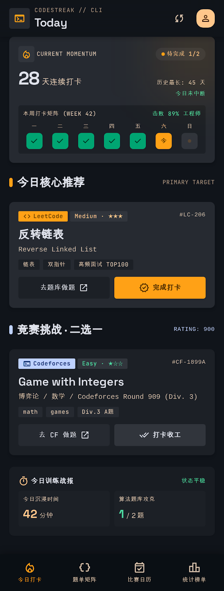

# 今日打卡页（P-01）



> 原型：[code.html](../产品原型/codestreak_1/code.html)｜契约以本文与 [组件规范](../02-设计规范/05-组件规范.md) 为准，截图仅用于视觉对照。

## 1. 页面目标与核心任务

P-01 是 CodeStreak 的默认落地页与**唯一打卡入口**，承载"今天是否达标 / 还差几题 / 现在做哪题"三件事。**非目标**：题库检索与筛选（P-02）、补签（P-04 / P-10，C-38）、历史日历（P-04，C-32）。

| # | 核心任务 | 对应区块 | 成功判据 |
| --- | --- | --- | --- |
| 1 | 3 秒内判定今日状态：已完成 n/2、连续天数、今日是否已中断 | C-04 状态胶囊 + 主数字 + 今日徽记 | 首屏无滚动即可读到三项 |
| 2 | 提供唯一行动路径：核心推荐 1 题 + 竞赛挑战 1 题，做完当场打卡 | C-06 / C-07 | 从进入页面到"已打卡 AC"≤ 2 次点击 |
| 3 | 用周矩阵、击败率与 C-16 收束正反馈，形成"打开—做题—打卡—连胜 +1"闭环 | C-04 矩阵 / C-16 | 打卡后 300ms 内出现庆祝弹窗，主数字 +1 |

引用：[原型](../产品原型/codestreak_1/code.html)、[截图](../产品原型/codestreak_1/screen.png)；组件行为见[组件规范](../02-设计规范/05-组件规范.md)，弹层通用规则见[弹层与全局状态](06-弹层与全局状态.md)。

## 2. 入口、退出与信息优先级

| 类型 | 入口 / 出口 | 行为 |
| --- | --- | --- |
| 主入口 | C-02 第 1 项「今日打卡」 | 冷启动默认落地；Tab 图标 `local_fire_department` |
| 深链 | `today`、推送「今日还差 2 题」、桌面卡片 | 打开后定位到 C-04，不自动滚动 |
| 切出 | 切换到其他 Tab | 保留滚动位置、卡片状态与弹窗栈，不重置 |
| 返回 | Tab 根页返回键 | 先关闭 C-16 / C-17 / C-18 → 再退至后台（不 pop 路由） |

信息优先级（视觉权重自上而下）：

| 层级 | 内容 | 依据 |
| --- | --- | --- |
| P0 | 状态胶囊「待完成 1/2」、主数字 28、今日徽记 | 唯一状态判读源，字号最大、色彩配额最高 |
| P1 | C-06 / C-07 的标题与「完成打卡」按钮 | 行动入口，主按钮为全页唯一琥珀实心块 |
| P2 | 周矩阵 7 列、击败 89%、历史最长 64 天 | 动机维持，`label-sm` 小字 |
| P3 | 今日训练战报（42 分钟 / 1/2 题） | 事后回顾，`surface.low` 最低层级 |

## 3. 布局树

```text
P-01 今日打卡
├─ C-01 AppBar（64vp fixed，surface@85% + 模糊）
│  ├─ 左：终端图标块 36 ─「CODESTREAK // CLI」/「Today」
│  └─ 右：同步 C-11 44×44 ─ 头像 28 圆形（原型 32，按 C-01 规范取 28）
├─ Scroll 内容容器（顶 72 / 左右 16 / 底 88，竖排 gap 20）
│  ├─ ① C-04 StreakHeroCard（surface.high）
│  │  ├─ 头部：火焰块 28 +「CURRENT MOMENTUM」┊ 胶囊「● 待完成 1/2」
│  │  ├─ 数值：28（32fp/700）+「天连续打卡」┊ 历史最长: 64 天 / 今日未中断
│  │  └─ C-05（surface.container）：「本周打卡矩阵 (WEEK 42)」┊「击败 89% 工程师」
│  │     └─ 7 列：一 二 三 四 五〔已打卡〕· 六〔今日〕· 日〔未来〕
│  ├─ ② C-03「今日核心推荐」+「PRIMARY TARGET」→ C-06（surface.high）
│  │  ├─ LeetCode ─「Medium · ★★★」┊ #LC-206 / 反转链表 / Reverse Linked List
│  │  └─ 链表·双指针·高频面试 TOP100 / 〔去题库做题〕〔完成打卡〕
│  ├─ ③ C-03「竞赛挑战 · 二选一」+「RATING: 900」→ C-07（surface.container）
│  │  ├─ Codeforces ─「Easy · ★☆☆」┊ #CF-1899A / Game with Integers
│  │  └─ 博弈论 / 数学 / Round 909 (Div. 3) / math·games·Div.3 A题 / 〔去 CF 做题〕〔打卡收工〕
│  ├─ ④ 今日训练战报（surface.low）：计时图标 + 标题 ┊「状态平稳」→ C-08×2（42 分钟 / 1 / 2 题）
│  └─ ⑤ 底部留白 88vp
└─ C-02 BottomTabBar（64vp + 安全区，第 1 项选中）
```

## 4. 逐区块规格

| 区块 | 尺寸 | 内边距 | 圆角 | 背景 / 描边 | 文本与字号 |
| --- | --- | --- | --- | --- | --- |
| C-01 AppBar | 高 64vp（+ 状态栏） | 左右 16vp | 0 | `cs.color.surface` @85% + 模糊 24vp；底缘阴影 `0 1vp 8vp rgba(0,0,0,0.25)` | 眉标 `label-sm` 10fp `cs.color.text.tertiary`；标题 `headline-sm` 20fp `cs.color.text.primary` |
| 内容容器 | 宽 328vp（360−32） | 16vp | — | `cs.color.surface` | — |
| C-04 | 328 × ≈204vp | 16vp | 12vp | `cs.color.surface.high` + `cs.color.primary.glow` 光斑 144vp（右上 −40,−40） | 见 5.1 |
| C-03（推荐） | 高 28vp | 0 | — | 2×16vp 竖条（圆角 full）`cs.color.primary.container` | 标题 `headline-sm` 20fp/600；尾注 `label-sm` 10fp `cs.color.text.tertiary` 大写 |
| C-06 | 328 × ≈184vp | 16vp | 12vp | `cs.color.surface.high` + 1vp `cs.color.primary` @20% 描边 | 见 6 |
| C-03（竞赛） | 高 28vp | 0 | — | 2×16vp 竖条 `cs.color.tertiary` | 标题 `headline-sm`；尾注 `label-sm` `cs.color.tertiary` 等宽字体 |
| C-07 | 328 × ≈184vp | 16vp | 12vp | `cs.color.surface.container`，无描边 | 见 7 |
| 战报容器 | 328 × ≈124vp | 16vp | 12vp | `cs.color.surface.low` | 见 8 |
| C-08 | 各 144 × 64vp | 8vp | 8vp | `cs.color.surface.container` | 标签 `label-sm`；数值 `headline-sm` 20fp/700 |
| C-02 | 高 64vp + 安全区 | 左右 4vp | 0 | `cs.color.surface.lowest` @90% + 模糊；顶缘 1vp 阴影 | 选中 `cs.color.primary.container`，未选 `cs.color.text.secondary`；图标 22vp + `label-sm` 10fp |

## 5. C-04 StreakHeroCard 细节

| 子元素 | 尺寸 / 位置 | 令牌 | 文案 |
| --- | --- | --- | --- |
| 火焰图标块 | 28×28vp，圆角 8vp，图标 18vp | 底 `cs.color.surface.highest`，图标 `cs.color.primary.container` | — |
| 眉标 | 与图标块间距 4vp | `cs.color.text.secondary`，`label-sm` 10fp，字距 0.05em，全大写 | `CURRENT MOMENTUM` |
| 状态胶囊 | 高 22vp，左右 10vp，上下 4vp，圆角 full，底 `cs.color.surface.highest` | 文本 `cs.color.primary`，`label-sm` 10fp；圆点 6×6vp `cs.color.primary.container` | `待完成 1/2` |
| 脉冲圆点 | 6×6vp，1.6s `ease-in-out` 循环，不透明度 1→0.35→1；系统"减少动效"开启时静止 | — | — |
| 主数字 + 单位 | 数字 `headline-xl-mobile` 32fp/40、700、字距 −0.02em；单位 `body-md` 14fp/20；两者间距 4vp 基线对齐 | 数字 `cs.color.text.primary`；单位 `cs.color.text.secondary` | `28` `天连续打卡` |
| 右侧两行 | 右对齐，行高 14vp；上行 `cs.color.text.secondary`，下行 `cs.color.secondary` | `label-sm` 10fp | `历史最长: 64 天` / `今日未中断` |
| 矩阵块 | 内嵌，上下 8vp 外边距 12vp；底 `cs.color.surface.container`，圆角 8vp，内边距 8vp | — | — |
| 矩阵标题行 | 左右对齐，下边距 8vp | `label-sm` 10fp `cs.color.text.secondary` | `本周打卡矩阵 (WEEK 42)` / `击败 89% 工程师` |
| 日列 | 7 等分（约 34.8vp/列），列间距 6vp；日标签 `label-sm` 与徽记间距 4vp | 日标签 `cs.color.text.secondary`；今日列 `cs.color.primary` | `一 二 三 四 五 六 日` |
| 徽记 | 28×28vp，圆角 6vp，居中 | 见 5.2 | 勾 / `今` / 圆点 |

### 5.2 周矩阵单元状态

| 状态 | 徽记底 | 徽记内容 | 文本 / 图标令牌 | 备注 |
| --- | --- | --- | --- | --- |
| 已打卡（过去） | `cs.color.secondary.container` | `check` 16vp | `cs.color.secondary.on-container` | 五列同构，不加描边 |
| 今日未打卡 | `cs.color.primary.container` + 1vp 阴影 | 文本「今」10fp/700 | `cs.color.primary.on-container`；日标签 `cs.color.primary` | 仅当天一列，位置由服务端 `date` 决定 |
| 今日已打卡 | `cs.color.secondary.container` | `check` 16vp | `cs.color.secondary.on-container`；日标签保持 `cs.color.primary` | 打卡后 200ms 替换，"今天"标识不消失 |
| 未来 | `cs.color.surface.highest` | 6×6vp 圆点 4vp 居中 | 圆点 `cs.color.border.subtle`；日标签 `cs.color.text.secondary` | 不可点击 |
| 过去空缺（断签） | `cs.color.surface.highest` | 6×6vp 圆点 | 圆点 `cs.color.border.subtle`；日标签 `cs.color.text.tertiary` | 补充规则：与"未来"的区别仅在日标签颜色 |
| 已补签 | `cs.color.secondary.container` @40% | `check` 16vp | `cs.color.secondary` | 补充规则；补签入口在 P-04 / P-10 |

## 6. C-06 TargetCard 细节

| 元素 | 规格 | 令牌 / 字号 | 文案 |
| --- | --- | --- | --- |
| 徽标行 | 平台徽标高 20vp、左右 8vp、上下 2vp、圆角 4vp、图标 `code` 14vp；右侧编号 10fp 等宽右对齐 | 底 `cs.color.platform.leetcode`（实心），文本 `cs.color.primary.on-container`；编号 `cs.color.text.secondary`；`label-sm` 10fp/600 | `LeetCode` ┊ `#LC-206` |
| 难度徽标 | 高 20vp，圆角 4vp | 底 `cs.color.difficulty.3` @20%，文本 `cs.color.difficulty.3`；`label-sm` | `Medium · ★★★` |
| 标题 | `headline-sm` 20fp/28，600，下边距 4vp | `cs.color.text.primary` | `反转链表` |
| 英文名 | `body-sm` 12fp/18，等宽字体，下边距 8vp | `cs.color.text.secondary` | `Reverse Linked List` |
| 标签 ×3 | 高 18vp，左右 8vp，上下 2vp，圆角 4vp，间距 6vp，下边距 12vp | 底 `cs.color.surface.container`，文本 `cs.color.text.secondary`；`label-sm` | `链表` `双指针` `高频面试 TOP100` |
| 次按钮 C-10 | 2 列等分，间距 8vp，高 36vp，圆角 8vp | 底 `cs.color.surface.container`，文本 `cs.color.text.primary`，图标 `open_in_new` 16vp；`label-md` 12fp | `去题库做题` |
| 主按钮 C-09 | 同上；图标 `verified` 18vp | 底 `cs.color.primary.container`，文本 `cs.color.primary.on-container`，`label-md` 600 | `完成打卡` |

- 外链：`https://leetcode.cn/problems/reverse-linked-list/`，`target="_blank"` 语义 → ArkUI 调 `@ohos.app.ability.common` 的 `openLink`，失败降级内置 WebView。
- 按钮按压：缩放 0.98 + 120ms `ease-out`，抬手回弹；主按钮额外 `brightness` +5%。
- 主按钮为本页**唯一**琥珀实心控件，区域内不得再出现第二个（令牌 6.1 配额）。

## 7. C-07 ContestChallengeCard 细节

| 元素 | 规格 | 令牌 / 字号 | 文案 |
| --- | --- | --- | --- |
| 平台徽标 | 高 20vp，圆角 4vp；图标 `terminal` 14vp | 实心：底 `cs.color.tertiary`，文本 `cs.color.tertiary.on-container`；`label-sm` 600 | `Codeforces` |
| 难度徽标 | 同规格 | 底 `cs.color.difficulty.1` @20%，文本 `cs.color.difficulty.1`；`label-sm` | `Easy · ★☆☆` |
| 编号 | 右对齐 | `cs.color.text.secondary`，`label-sm` 10fp，等宽 | `#CF-1899A` |
| 标题 | `headline-sm` 20fp/28，600，下边距 4vp | `cs.color.text.primary` | `Game with Integers` |
| 副标题 | `body-sm` 12fp/18，等宽，下边距 8vp，单行省略 | `cs.color.text.secondary` | `博弈论 / 数学 / Codeforces Round 909 (Div. 3)` |
| 标签 ×3 | 高 18vp，圆角 4vp，下边距 12vp | 底 `cs.color.surface.high`（比卡片亮一级），文本 `cs.color.text.secondary` | `math` `games` `Div.3 A题` |
| 次按钮 | 同 6 节次按钮 | 底 `cs.color.surface.high`，文本 `cs.color.text.primary`；图标 `open_in_new` 16vp | `去 CF 做题` |
| 打卡按钮 | 同规格，图标 `done_all` 18vp | 底 `cs.color.surface.highest`，文本 `cs.color.text.primary`，600；完成后转 `cs.color.secondary.container` | `打卡收工` |

- 外链：`https://codeforces.com/problemset/problem/1899/A`。
- "二选一"含义：C-06 与 C-07 各自独立计入 2 题目标，**不要求**两题都来自不同平台；C-07 的挑战题按 `RATING: 900` 由服务端按用户 CF rating 动态匹配。
- 卡片层级低于 C-06（`surface.container` vs `surface.high`），刻意让推荐卡更亮，符合令牌 L2 / L3 分层。

## 8. 今日训练战报（C-08 组合）

| 元素 | 规格 | 令牌 / 字号 | 文案 |
| --- | --- | --- | --- |
| 容器 | 328 × ≈124vp，内边距 16vp，圆角 12vp | 底 `cs.color.surface.low` | — |
| 头部 | `timer` 图标 18vp + 文案 `label-md` 12fp/600（间距 4vp）；右侧状态词右对齐 | 图标与标题 `cs.color.primary` / `cs.color.text.primary`；状态词 `cs.color.secondary` `label-sm` | `今日训练战报` / `状态平稳` |
| C-08 左 | 144×64vp，内边距 8vp，圆角 8vp | 标签 `label-sm` `cs.color.text.secondary`；数值 20fp/700 `cs.color.primary`；单位 `body-sm` 12fp `cs.color.text.secondary` | `今日沉浸时间` / `42` `分钟` |
| C-08 右 | 同上 | 数值 `cs.color.secondary` | `算法题库攻克` / `1` `/ 2 题` |

- 状态词按规则生成：`状态平稳`（0–59 分钟）/ `状态专注`（60–119 分钟）/ `超常发挥`（≥120 分钟）/ `尚未开始`（0 分钟且 0 题），补充规则，需与 P-04 统一口径。

## 9. 交互规格

### 9.1 完成打卡主流程（以 C-06 为例，C-07 同构）

1. 点击「完成打卡」→ 立即置按压态（缩放 0.98，120ms）。
2. 本地先记 `pending`，按钮进入 500ms loading（图标替换为 `progress_activity` 旋转），防重复点击。
3. `POST /v1/checkins`，请求体见 11 节；幂等键 `hash(userId + date + problemId)`。
4. 成功：按钮 200ms 过渡为「已打卡 AC」——底 `cs.color.secondary.container`、文本 `cs.color.secondary.on-container`、图标 `task_alt` 18vp，`enabled(false)`，保持 36vp 高度不变形。
5. 卡片整体不透明度降至 0.9（`opacity(0.9)`），延后 200ms 让按钮先完成换色。
6. C-08 计数 `1 → 2`，数字做 200ms 上滚（旧值上移 12vp 淡出，新值自下 12vp 淡入）。
7. 状态胶囊文案互斥切换：`待完成 1/2` → `今日已拉满 2/2`（同一 `Text` 节点，不做并排）。
8. 主数字 `28 → 29` 做 300ms 数字滚动（`历史最长` 不变），今日徽记 200ms 变翡翠勾（5.2 行三）。
9. 300ms 后弹出 C-16；弹窗关闭后焦点回到被禁用的按钮（仅可读）。

- 若第 2 次打卡使 `solvedToday = 2`，主数字**不再**滚动（连续天数当天只 +1），仅 C-08 与胶囊变化；另一张卡片始终可点。

### 9.2 C-16 庆祝弹窗（O-01）

| 元素 | 规格 | 文案 |
| --- | --- | --- |
| 遮罩 | 全屏 `cs.color.surface.dim` @80% + 模糊 12vp，点击可关闭 | — |
| 卡片 | 宽 min(320, 屏宽−32)vp，内边距 16vp，圆角 12vp，底 `cs.color.surface.high`，居中 | — |
| 徽章 | 56×56vp 圆形，底 `cs.color.secondary.container`，图标 `military_tech` 32vp | — |
| 眉标 | `label-sm` 10fp，字距 0.1em，`cs.color.secondary`，全大写 | `ACCEPTED! 连续达成` |
| 标题 | `headline-sm` 20fp/28，`cs.color.text.primary`，下边距 4vp | `打卡成功，连胜延续！` |
| 正文 | `body-sm` 12fp/18，`cs.color.text.secondary`，下边距 16vp | `记录已同步至云端矩阵。今日完成度升级，坚持就是极客的力量！` |
| 数据条 | 内边距 8vp，圆角 8vp，底 `cs.color.surface.container`，左右两列 | `连续天数` `29 DAYS 🔥`（`label-lg` 14fp 700 `cs.color.primary`）/ `获得积分` `+25 EXP`（`cs.color.secondary`） |
| 主按钮 | 全宽 36vp，圆角 8vp | 底 `cs.color.primary.container`，文本 `cs.color.primary.on-container`，`label-md` 600，文案 `收到，继续冲刺` |

- 入场：遮罩 200ms 淡入，卡片 300ms `scale 0.95 → 1`（弹性曲线，回弹 ≤ 4%），徽章 600ms 弹跳一次；关闭反向 200ms 后卸载。
- 第 2 次打卡（当日达标）替换眉标为 `DAILY GOAL CLEARED`、标题为 `今日目标达成，连胜 +1`，其余不变；同一天最多弹出 2 次。
- 关闭方式：主按钮 / 点击遮罩 / 返回键；关闭不写埋点以外的状态，不重复弹出同一次打卡。
- 无障碍：弹窗出现即把焦点移入主按钮，读屏播报标题与正文；遮罩外元素 `accessibilityLevel("no")`。

### 9.3 同步按钮

- 点击 C-11：图标 `sync` 800ms 匀速旋转一周，按钮 `enabled(false)`。
- 调 `POST /v1/sync`：成功 C-18 Toast「已同步 4 个平台 · 刚刚」（`cs.color.surface.inverse` 底、`cs.color.text.inverse` 文本，2.5s）；失败 Toast「同步失败，点击重试」，并把 C-11 图标改为 `sync_problem` 直至下次成功。
- 同步成功后刷新：连续天数、周矩阵、C-06/C-07 的 AC 状态、C-08 计数；**不**重置滚动位置。

### 9.4 外链与返回标记

1. 点击「去题库做题」/「去 CF 做题」→ 记录 `p01_external_open`，调系统浏览器（或内置 WebView，按 P-10 偏好）。
2. 返回 App 后 3s 内，若该题仍未 AC，在 TabBar 上方 8vp 处浮出操作条：「刚才做完了？」+ 主按钮「标记 AC」+ 次按钮「忽略」，5s 自动收起（可左滑关闭）。
3. 点「标记 AC」直接走 9.1 的打卡流程（跳过 loading 文案），成功后同样弹 C-16。
4. 若离开时长 > 10 分钟，或该题已在服务端同步为 AC，则不浮出。

### 9.5 下拉刷新与手势

- `Refresh` 组件挂在内容容器顶部，下拉阈值 64vp；刷新同时拉 11 节的 3 个接口，最短展示 600ms，成功后收起并 C-18 提示「数据已刷新」。
- 刷新期间保留旧数据（不清屏），仅顶部显示 20vp 进度条；禁止整页 Skeleton 闪烁。
- 左滑返回（系统手势）在 Tab 根页不触发任何路由行为；若 C-16 打开，优先关闭弹窗。

## 10. 状态矩阵

| 状态 | 判定 | C-04 胶囊 | 主数字 | 今日徽记 | C-06 按钮 | C-07 按钮 | 说明 |
| --- | --- | --- | --- | --- | --- | --- | --- |
| 未打卡 | `solvedToday = 0` | `待完成 0/2` | 28 | 琥珀「今」 | 完成打卡 | 打卡收工 | 默认态，截图基准 |
| 部分完成 | `solvedToday = 1` | `待完成 1/2` | 28 | 琥珀「今」 | 可点 / 已打卡 | 可点 / 已打卡 | 原型初始态 |
| 已达标 | `solvedToday ≥ 2` | `今日已拉满 2/2` | 29 | 翡翠勾 | 已打卡 AC | 已打卡 AC | 两文案互斥，不同时出现 |
| 断签风险 | 本地 22:00 后且 `solvedToday < 2` | `距结算 01:58 · 差 2 题` | 28 | 琥珀「今」+ 呼吸加速 | 可点（主按钮闪烁 1 次） | 可点 | 补充规则；胶囊底转 `cs.color.primary` @20%，圆点停止脉冲 |
| 离线 | 无网络且 24h 内有缓存 | 保留缓存文案 + 前置 `offline_pin` 图标 | 缓存值 | 缓存态 | 可点（入队） | 可点（入队） | 打卡走本地队列，恢复后重放 |
| 同步中 | 首次进入 / 手动同步 | Skeleton 占位 88×22vp | Skeleton 40×40vp | 灰点 | 半透明禁用 | 半透明禁用 | C-40 骨架，不用转圈整屏 |
| 无推荐 | 推荐接口返回空 | 正常 | 正常 | 正常 | 区域内 C-39「今日推荐生成中」+「重新生成」 | 同左 | 战报与矩阵不受影响 |

## 11. 数据来源与刷新时机

| 数据 | 接口 | 关键字段 | 刷新时机 |
| --- | --- | --- | --- |
| 今日状态 | `GET /v1/today` | `date`、`streak.current`、`streak.longest`、`week[]`（`date`/`status`）、`weekNo`、`beatPercent`、`solvedToday`、`goal=2`、`serverTime` | 进入页面、下拉刷新、打卡成功、跨天 00:00、App 回前台 |
| 今日推荐 | `GET /v1/recommendations/today` | `core{platform, external_id, title_zh, title_en, difficulty_norm, difficulty_label, tags[], url}`、`contest{rating, contest_name, ...}` | 同上；打卡后仅取另一题的 `ac` 状态 |
| 训练战报 | `GET /v1/reports/today` | `focusMinutes`、`solvedCount`、`statusText` | 进入页面、打卡成功、每 5 分钟节流刷新 |
| 打卡写入 | `POST /v1/checkins` | 请求 `{problemId, platform, date, source: "p01"}`；响应 `{streak, xp, alreadyChecked}` | 点击「完成打卡」 |
| 平台同步 | `POST /v1/sync` | 响应 `{platforms[], lastSyncAt, conflicts[]}` | 点击同步、App 回前台且距上次 > 30 分钟 |

- 打卡日：以服务端 `Asia/Shanghai` 自然日 00:00 为界，客户端不自行推断；`serverTime` 与本地偏差 > 5 分钟时以服务端为准并在 13 节处置。
- 缓存：`AppStorage` 键 `cs.today.snapshot`，保留 24h，离线时直接渲染并标记。

## 12. 埋点

| 事件 | 触发 | 参数 |
| --- | --- | --- |
| `p01_view` | 页面可见 | `solvedToday`、`streak`、`from`（tab/deeplink/push） |
| `p01_checkin_click` | 点击任一打卡按钮 | `problemId`、`platform`、`difficultyNorm`、`slot`（core/contest） |
| `p01_checkin_success` | 接口成功 | `problemId`、`streakAfter`、`xp`、`elapsedMs` |
| `p01_checkin_fail` | 接口失败 | `problemId`、`errorCode`、`retry` |
| `p01_celebrate_show` / `p01_celebrate_close` | 弹窗出现 / 关闭 | `variant`（first/goal）、`dwellMs` |
| `p01_sync_click` / `p01_sync_result` | 同步按钮 | `result`、`conflicts` |
| `p01_external_open` | 点击外链 | `platform`、`problemId`、`target`（browser/webview） |
| `p01_mark_ac_from_resume` | 返回浮条点「标记 AC」 | `delayMs`、`problemId` |
| `p01_pull_refresh` | 下拉刷新 | `durationMs`、`result`；与 `p01_sync_result` 共用 `result` 枚举 |

## 13. 边界与异常

| 场景 | 表现 | 处理 |
| --- | --- | --- |
| 跨天 00:00 仍在前台 | 连续天数未 +1，胶囊仍显示旧日 | 本地定时器在 00:00:05 触发 `GET /v1/today`；若 `date` 变化则整页刷新，C-18 提示「新的一天，目标已重置」，并关闭 C-16；若判定昨日断签，C-04 右侧第二行改为 `连续中断` 且用 `cs.color.error` |
| 设备时区与服务端不一致 | 本地显示日期与服务端不符 | 一律以服务端 `date` 渲染；时区差 > 12h 时在战报卡下方显示 12fp 提示「按北京时间计日」 |
| 重复打卡 / 双击 | 出现两次成功、连续天数 +2 | 幂等键去重；客户端按钮点击即禁用；服务端返回 `alreadyChecked: true` 时静默纠正为已打卡态，不弹 C-16 |
| 无网络 | 打卡失败 | 按钮回滚为可点，C-18「网络异常，已加入待同步队列」；队列在恢复网络后重放，成功仍弹 C-16 |
| 外链无法打开 | 点击无反应 | 降级内置 WebView；仍失败则 C-18「无法打开链接，请检查题库 App 是否安装」，并保留「标记 AC」 |
| 推荐接口超时（>5s） | 区块空白 | 显示 C-40 骨架 5s，超时后 C-39「推荐加载失败」+「重试」；C-04 与战报不受影响 |
| 打卡成功但同步失败 | 本地已 +1，云端未记 | 保留本地乐观值并打 `pending` 标记，下次进入页面以服务端为准，必要时回滚并提示 |
| 系统字体放大 / 无障碍 | 卡片文字换行挤压 | 标题最多 2 行；`headline-xl-mobile` 数字不缩放（固定 32fp）；按钮文案不换行，超长省略 |

## 14. 验收清单

- [ ] C-01 高 64vp、背景模糊、内容首块顶距 72vp，滚动时 AppBar 不随内容移动且不出现白边。
- [ ] C-04 呈 `cs.color.surface.high` + `cs.color.primary.glow` 光斑，光斑不裁剪出圆角外。
- [ ] 主数字 32fp/700，初始 28；首次打卡后 **28 → 29** 有 300ms 数字滚动，同日第二次打卡不再滚动。
- [ ] 状态胶囊仅有三种文案：`待完成 0/2`、`待完成 1/2`、`今日已拉满 2/2`，**互斥显示**，且 1/2 时圆点脉冲。
- [ ] 周矩阵 7 列等分、列间距 6vp；今日列为琥珀「今」，打卡后变翡翠勾且日标签仍为琥珀。
- [ ] C-06 与 C-07 的徽标、编号、标题、副标题、3 个标签文案与第 6/7 节逐字一致。
- [ ] C-06 主按钮为全页唯一琥珀实心块，文本为 `cs.color.primary.on-container`，对比度 ≥ 4.5:1。
- [ ] 点击「完成打卡」：按钮 200ms 转「已打卡 AC」并禁用，卡片不透明度 0.9，C-08 计数 1 → 2。
- [ ] C-16 在打卡成功后 300ms 内出现，数据条显示 `29 DAYS 🔥` 与 `+25 EXP`，三种关闭方式均可用。
- [ ] 次日达标第 2 题时 C-16 文案切换为 `DAILY GOAL CLEARED`，全天最多 2 次。
- [ ] 外链返回后 3s 内浮出「标记 AC」，5s 自动收起，点击可完成打卡并弹 C-16。
- [ ] 同步按钮点击后旋转 800ms，成功/失败 Toast 文案与第 9.3 节一致。
- [ ] 离线状态下打卡进入队列，恢复网络后重放且不产生重复计数。
- [ ] 跨天 00:00 停留页面时自动刷新，连续天数与胶囊同步重置，无重复弹窗。
- [ ] 全页无裸 HEX，颜色全部经 `$r('app.color.cs_color_*')` 或 `CsColor.*` 引用。

## 15. 变更记录

| 版本 | 日期 | 变更 | 作者 |
| --- | --- | --- | --- |
| v1.0 | 2026-10-26 | 首版：按 codestreak_1 原型逐区块定稿；补充断签风险/离线/同步中状态、外链返回标记 AC、跨天与时区处理、埋点与 15 条验收 | 交互设计组 |
