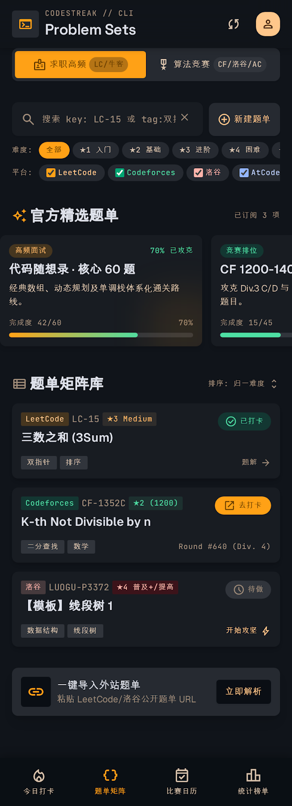

# 题单矩阵页（P-02）



> 原型：[code.html](../产品原型/codestreak_2/code.html)｜题号统一 `LC/CF/LG/AC-` 前缀，截图中的 `LUOGU-P3372` 按 [D-43](../06-附录/01-原型差异与设计裁决.md) 修正为 `LG-P3372`。

## 1. 页面目标与核心任务

P-02 是题单与题目的**检索与编排中枢**：在"求职高频 / 算法竞赛"双赛道下，用一套筛选与搜索把 4 个平台的题目收敛成可直接开工的队列。**非目标**：题目正文与题解渲染（P-06）、题单内排序编辑（O-02 仅建单）、账号绑定（P-09）。

| # | 核心任务 | 对应区块 | 成功判据 |
| --- | --- | --- | --- |
| 1 | 切赛道即切题源视野：求职（LeetCode / 牛客）与竞赛（CF / 洛谷 / AtCoder）互不干扰 | C-19 + C-22 | 切换后 300ms 内列表与平台复选同步刷新 |
| 2 | 难度 + 平台 + 搜索三条件在 2 次操作内把目标题收敛到 ≤5 条 | C-21 / C-22 / C-20 | 条件组合结果可预期，0 结果时有挽回路径 |
| 3 | 从题单卡或题目行一步开工：外链做题、标记打卡、进入详情（规划） | C-23 / C-24 | 行内「去打卡」≤ 1 次点击，不离开本页 |

引用：[原型](../产品原型/codestreak_2/code.html)、[截图](../产品原型/codestreak_2/screen.png)；组件行为见[组件规范](../02-设计规范/05-组件规范.md)，抽屉与 Toast 通用规则见[弹层与全局状态](06-弹层与全局状态.md)。

## 2. 入口与信息优先级

| 类型 | 入口 / 出口 | 行为 |
| --- | --- | --- |
| 主入口 | C-02 第 2 项「题单矩阵」 | 保留上次赛道、筛选、搜索与滚动位置 |
| 深链 | `problem-sets?track=cp`、推送「今日挑战题来自 CF」 | 参数优先于缓存，预置赛道后再加载 |
| 浮层 | O-02 创建题单、O-03 导入题单 | 不新建路由，覆盖 TabBar，返回键先关浮层 |
| 出口 | 行/卡点击 → P-05 / P-06（规划） | 返回后恢复滚动位置与筛选，行状态按最新 AC 重算 |

信息优先级：**P0** 赛道分段 C-19 与搜索行 C-20（首屏顶部，滚动 120vp 后吸顶）> **P1** 题目行 C-24 的标题与状态控件 > **P2** 官方精选题单 C-23 > **P3** 难度/平台筛选与导入条 C-25。

## 3. 布局树

```text
P-02 题单矩阵
├─ C-01 AppBar（64vp，标题 "Problem Sets"）
├─ List 内容容器（顶 72 / 左右 16 / 底 88，区块间 28）
│  ├─ ① C-19 双赛道分段（surface.high，44vp）：〔求职高频 · LC/牛客〕⟷〔算法竞赛 · CF/洛谷/AC〕
│  ├─ ② 搜索行（间距 8vp）：C-20 搜索框（flex 1，44vp）+「新建题单」（44vp）
│  ├─ ③ 筛选区（行距 4vp）
│  │     ├─ C-21 难度行：难度: 全部 · ★1 入门 · ★2 基础 · ★3 进阶 · ★4 困难 · ★5 挑战（横滑）
│  │     └─ C-22 平台行：平台: ☑LeetCode ☑Codeforces ☑洛谷 ☑AtCoder（横滑）
│  ├─ ④ C-03「官方精选题单」+「已订阅 3 项」→ 横滑 C-23 ×3（270vp + 12vp，snap-start，出血到边缘）
│  │     代码随想录 42/60 70% / CF 1200-1400 突破营 15/45 33% / 剑指 Offer 67/75 89%
│  ├─ ⑤ C-03「题单矩阵库」+「排序: 归一难度 ⇅」→ C-24 ×3（行距 12vp）
│  │     LC-15 三数之和〔已打卡〕/ CF-1352C K-th Not Divisible by n〔去打卡〕/ LG-P3372 线段树 1〔待做〕
│  ├─ ⑥ C-25 导入条（surface.high，64vp）
│  └─ ⑦ 底部留白 88vp
├─ C-02 BottomTabBar（64vp + 安全区，第 2 项选中）
└─ 浮层：O-02 创建抽屉 / O-03 导入抽屉 / C-18 Toast
```

## 4. 逐区块规格

| 区块 | 尺寸 | 内边距 | 圆角 | 背景 / 描边 | 文本与字号 |
| --- | --- | --- | --- | --- | --- |
| C-01 | 高 64vp | 左右 16vp | 0 | `cs.color.surface` @85% + 模糊 | 眉标 `CODESTREAK // CLI` `label-sm` `cs.color.text.tertiary`；标题 `Problem Sets` `headline-sm` |
| 内容容器 | 宽 328vp | 顶 72 / 左右 16 / 底 88 | — | `cs.color.surface` | 区块间 28vp，区块内 8–12vp |
| C-19 | 328×44vp | 4vp | 12vp | `cs.color.surface.high` | 见 5 |
| 搜索行 | 328×44vp，间距 8vp | — | — | — | 见 6 |
| C-21 行 | 高 28vp，横滑 | 0 | full | 选中 `cs.color.primary.container`；未选 `cs.color.surface.high` | 前置标签 `label-sm` `cs.color.text.tertiary` |
| C-22 行 | 高 28vp，横滑 | 0 | full | 见 8 | 平台色 + `label-sm` 10fp |
| C-03（两处） | 高 28vp | 0 | — | 竖条 2×16vp（圆角 full）：精选区 `cs.color.primary.container`、题库区 `cs.color.text.tertiary` | 标题 `headline-sm` 20fp/600；尾注 `label-sm` `cs.color.text.tertiary` |
| C-23 | 270×≈150vp，间距 12vp | 12vp | 12vp | `cs.color.surface.low` | 见 9 |
| C-24 | 328×≈104vp，行距 12vp | 12vp | 12vp | `cs.color.surface.low`；左缘 3vp 平台色条 | 见 10 |
| C-25 | 328×64vp | 12vp | 12vp | `cs.color.surface.high` | 见 11 |
| C-02 | 64vp + 安全区 | 左右 4vp | 0 | `cs.color.surface.lowest` @90% + 模糊 | 第 2 项 `cs.color.primary.container` |

## 5. C-19 双赛道分段控制

| 元素 | 规格 | 令牌 / 字号 | 文案 |
| --- | --- | --- | --- |
| 容器 | 328×44vp，内边距 4vp | 底 `cs.color.surface.high`，圆角 12vp | — |
| 段按钮 | 各占一半（160vp），高 36vp，左右 12vp，圆角 8vp；图标 18vp + 间距 4vp | 选中底 `cs.color.primary.container`、文本 `cs.color.primary.on-container`、`label-md` 600；未选文本 `cs.color.text.secondary` | `求职高频`（`badge`）/ `算法竞赛`（`military_tech`） |
| 赛道徽章 | 高 18vp，左右 6vp，圆角 full | 选中底 `cs.color.surface.lowest` @30%、文本 `cs.color.primary.on-container`；未选底 `cs.color.surface.highest`、文本 `cs.color.text.secondary`；`label-sm` | `LC/牛客` / `CF/洛谷/AC` |

- 切换动效：选中块底色 150ms 交叉淡入（两段等宽，不做滑块位移）；列表 100ms 淡出、数据回来后 150ms 淡入；互斥单选、无"全部赛道"，默认取近 7 天打卡平台占比高的赛道，首次安装默认「求职高频」。

## 6. C-20 搜索与语法

| 元素 | 规格 | 令牌 / 字号 | 文案 |
| --- | --- | --- | --- |
| 搜索框 | 高 44vp（与右侧按钮齐平），左右 12vp，圆角 12vp；聚焦加 1vp `cs.color.primary.container` 描边 | 底 `cs.color.surface.low`；`search` 20vp `cs.color.text.tertiary`；输入 `label-md` `cs.color.text.primary` | 占位符 `搜索 key: LC-15 或 tag:双指针...` |
| 清除按钮 | 热区 32×32vp，图标 `close` 16vp，输入为空时隐藏 | `cs.color.text.tertiary`，按压转 `cs.color.text.primary` | — |
| 新建按钮 | 高 44vp，左右 12vp，圆角 12vp，`add_circle` 18vp | 底 `cs.color.surface.high`，文本与图标 `cs.color.primary`；`label-md` | `新建题单` |

| 语法 | 作用 | 示例 | 解析规则 |
| --- | --- | --- | --- |
| `key:` | 题号精确匹配 | `key:LC-15`、`key:CF-1352C` | 前缀 `LC/CF/AT/LG/NC` 大小写不敏感，编号去空格后与 `external_id` 全等 |
| `tag:` | 标签匹配 | `tag:双指针`、`tag:dp` | 与 `tags[]` 前缀 + 包含双向匹配；`dp`→`动态规划` 走同义词表 |
| `diff:` | 难度区间 | `diff:easy`、`diff:3`、`diff:2.5` | `easy`→1–2、`medium`→3、`hard`→4–5；数字按 0.5 步进取区间 |
| `platform:` | 平台 | `platform:cf`、`platform:洛谷` | `lc/leetcode`、`cf/codeforces`、`lg/luogu/洛谷`、`at/atcoder` 互为别名 |
| 裸词 | 全文 | `反转链表`、`3Sum` | 中英文标题、题号、标签四字段联合匹配，忽略大小写 |

1. 多条件 **AND**；同一 key 重复出现只取最后一个值。
2. 未知 key（`foo:bar`）整体降级为裸词，不报错、不阻断。
3. 值非法（`diff:hacker`）时该条件置红并提示「未识别的难度值」，其余条件仍生效。
4. 输入防抖 250ms；输入 `k/t/d/p` 首字母浮出建议浮层（宽 = 搜索框宽，最大 240vp，条目高 36vp，底 `cs.color.surface.high`，含最近搜索 3 / 热门标签 8 / 语法提示 4；↑↓ 选择、Enter 补全、Esc 收起）。
5. 命中关键词高亮 `cs.color.primary`；清除按钮只清空、不收起键盘焦点。

## 7. C-21 难度筛选与排序

| 元素 | 规格 | 令牌 | 说明 |
| --- | --- | --- | --- |
| 前置标签 | `难度:` `label-sm`，字距 0.05em，右内边距 4vp | `cs.color.text.tertiary` | 不参与横滑 |
| 单选 pill | 高 28vp，左右 10vp，圆角 full，间距 4vp，7 项 | 选中底 `cs.color.primary.container` + 文本 `cs.color.primary.on-container`；未选底 `cs.color.surface.high` + 文本 `cs.color.text.secondary` | `全部` `★1 入门` `★2 基础` `★3 进阶` `★4 困难` `★5 挑战` |
| 横滑提示 | 行右缘 16vp 渐变（`cs.color.surface` 90%→0） | — | 360vp 下 `★5 挑战` 被裁切，必须提示可滑 |
| 排序 | 行右侧「排序: 归一难度」+ `unfold_more` 16vp，点击弹 C-17 | `cs.color.text.tertiary`，`label-sm` | 归一难度（默认）/ 完成度 / 最近更新 / 平台 |

- 单选：点未选项即应用；点已选项**回退「全部」**（「全部」本身点击无变化）。排序规则：归一难度 = `difficulty_norm` 升序 → 同难度按平台序 LC→CF→洛谷→AC → `external_id`；完成度 = 题单 AC 比例降序；最近更新 = `updated_at` 降序；切换后列表回顶，筛选与横滑位置保留。

## 8. C-22 平台筛选（修正后）

| 平台 | 选中底 / 描边 | 选中文本与勾选 | 未选态 |
| --- | --- | --- | --- |
| LeetCode | `cs.color.platform.leetcode` @16% + 1vp @40% | `cs.color.primary`，`check` 12vp | 底 `cs.color.surface.high`、1vp `cs.color.border.subtle`、文本 `cs.color.text.secondary`、空心 12vp 方块 |
| Codeforces | `cs.color.tertiary` @16% + 1vp @40% | `cs.color.tertiary` | 同上 |
| 洛谷 | `cs.color.error` @16% + 1vp @40% | `cs.color.error` | 同上 |
| AtCoder | `cs.color.secondary` @16% + 1vp @40% | `cs.color.secondary` | 同上 |

- 尺寸：高 28vp，左右 10vp，圆角 full，间距 4vp，文本 `label-sm`；复选框热区补足至 44vp。多选、默认全选；**至少保留 1 项**，取消最后一项时恢复全选并 C-18 提示「至少保留一个平台」。
- 与赛道联动：求职赛道仅 LeetCode 有数据（牛客不进 C-22，见 15 节），竞赛赛道 CF/洛谷/AtCoder 有数据；不可用平台保留 40% 不透明度，点击 C-18 提示「该赛道暂无 AtCoder 数据」。

## 9. C-23 官方精选题单卡

| 元素 | 规格 | 令牌 / 字号 | 三张卡文案 |
| --- | --- | --- | --- |
| 卡片 | 270×≈150vp，内边距 12vp，圆角 12vp，横滑间距 12vp，snap-start | 底 `cs.color.surface.low`；右下 96vp 光斑 @10% | — |
| 主题徽章 | 高 18vp，左右 8vp，圆角 full | 卡 1 底 `cs.color.primary.container` @20% + 文本 `cs.color.primary.fixed-dim`；卡 2 `cs.color.secondary.container` @20% + `cs.color.secondary`；卡 3 `cs.color.tertiary.container` @20% + `cs.color.tertiary` | `高频面试` / `竞赛排位` / `经典必刷` |
| 右上状态 | `label-sm`，右对齐 | 卡 1、卡 3 `cs.color.secondary`；卡 2 `cs.color.text.secondary` | `70% 已攻克` / `33% 攻坚中` / `即将通关` |
| 标题 | `body-lg` 16fp/24，600，单行省略 | `cs.color.text.primary` | `代码随想录 · 核心 60 题` / `CF 1200-1400 突破营` / `剑指 Offer 经典必刷` |
| 描述 | `body-sm` 12fp/18，最多 2 行 | `cs.color.text.secondary` | `经典数组、动态规划及单调栈体系化通关路线。` / `攻克 Div.3 C/D 与 Div.2 B/C 贪心与二分分水岭题目。` / `国内大厂考察极高频的代码与数据结构模版题。` |
| 完成度行 | `label-sm`，左右对齐，上下间距 6vp | `cs.color.text.tertiary` | `完成度 42/60` `70%` / `15/45` `33%` / `67/75` `89%` |
| 进度条 C-15 | 高 6vp，圆角 full；槽 `cs.color.surface.highest` | 填充 `线性渐变 cs.color.primary.container → cs.color.secondary`（令牌 8.2） | 宽度 70% / 33% / 89% |

- 横滑容器：负 16vp 出血 + 内 16vp，`scrollBar(Off)`，snap 到卡左缘，首卡左缘与内容区对齐；3 张顺序固定，曝光按卡可见 ≥50% 计一次；点击进入 P-05（规划），未实现时 C-18 提示「题单详情即将上线」。

## 10. C-24 题目行（三态）

| 元素 | 规格 | 令牌 / 字号 | 三行文案 |
| --- | --- | --- | --- |
| 行容器 | 328×≈104vp，内边距 12vp，圆角 12vp，按压 `cs.color.surface.container` | 底 `cs.color.surface.low`；左缘 3vp 平台色条（圆角 2vp） | — |
| 徽标组 | 平台徽标高 18vp、左右 6vp、圆角 4vp；题号 `label-md` 12fp 等宽；难度徽标同规格 | 平台徽标：底平台色 @20% + 文本平台色；题号 `cs.color.text.tertiary`；难度底 `cs.color.difficulty.n` @20% + 同色文本 | `LeetCode` `LC-15` `★3 Medium` / `Codeforces` `CF-1352C` `★2 (1200)` / `洛谷` `LG-P3372` `★3 普及+/提高` |
| 标题 | `body-lg` 16fp/24，600，单行省略，上边距 4vp | `cs.color.text.primary` | `三数之和 (3Sum)` / `K-th Not Divisible by n` / `【模板】线段树 1` |
| 右侧状态 | 高 22–24vp，宽 72–88vp，圆角 full，图标 16vp + 间距 4vp | 见 10.1 | `已打卡` / `去打卡` / `待做` |
| 标签 ×2 | 高 18vp，左右 8vp，圆角 4vp，间距 4vp | 底 `cs.color.surface.highest`，文本 `cs.color.text.secondary` | `双指针` `排序` / `二分查找` `数学` / `数据结构` `线段树` |
| 行尾元信息 | `label-sm`，右对齐 | `cs.color.text.tertiary` | `题解 →` / `Round #640 (Div. 4)` / `开始攻坚 ⚡` |

### 10.1 三态与行尾动作

| 状态 | 判定 | 右侧控件 | 行尾动作 | 点击行为 |
| --- | --- | --- | --- | --- |
| 已打卡 | `my_status = solved` | 胶囊：底 `cs.color.secondary.container` @20%、文本 `cs.color.secondary`、图标 `check_circle` | `题解 →`（`cs.color.text.tertiary`，指向 P-06） | 整行进 P-06（规划） |
| 去打卡 | `todo` 且在今日推荐池 | 按钮：底 `cs.color.primary.container`、文本 `cs.color.primary.on-container`、图标 `open_in_new` | 平台赛事名（`label-sm` `cs.color.text.tertiary`） | 按钮外链做题；整行进 P-05/P-06 |
| 待做 | `todo` 且不在推荐池 | 胶囊：底 `cs.color.surface.highest`、文本 `cs.color.text.tertiary`、图标 `schedule` | `开始攻坚 ⚡`（`cs.color.primary`） | 行尾动作把题加入今日推荐并 C-18 提示 |

- 平台色条：LeetCode `cs.color.primary.container`、Codeforces `cs.color.tertiary`、洛谷 `cs.color.error`、AtCoder `cs.color.secondary`（新增规则，原型未实现，见 17 节 PD-08）；长按（规划）弹 C-17 操作表——加入今日 / 收藏 / 移出题单 / 复制题号，v1 仅「复制题号」可用。

## 11. C-25 导入条

| 元素 | 规格 | 令牌 / 字号 | 文案 |
| --- | --- | --- | --- |
| 容器 | 328×64vp，内边距 12vp，圆角 12vp | 底 `cs.color.surface.high` | — |
| 图标块 | 40×40vp，圆角 8vp，`link` 24vp | 底 `cs.color.surface.lowest`，图标 `cs.color.primary.container` | — |
| 标题 / 副标题 | `body-md` 500 / `body-sm` 12fp/18 | `cs.color.text.primary` / `cs.color.text.tertiary` | `一键导入外站题单` / `粘贴 LeetCode/洛谷公开题单 URL` |
| 按钮 | 高 36vp，左右 12vp，圆角 8vp，`label-md` | 底 `cs.color.surface.lowest`，文本 `cs.color.primary` | `立即解析` |

- 整条与右侧按钮合并为同一动作（打开 O-03），避免双热区竞争；点击打开 O-03：输入占位 `https://leetcode.cn/studyplan/... 或 洛谷题单`，提示条「支持自动提取各题题目号，并统一映射为系统归一化难度。」，底部 `返回` / `开始抓取同步`。

## 12. 交互规格

### 12.1 赛道切换联动

1. 平台复选重置为该赛道默认（求职：仅 LeetCode；竞赛：CF + 洛谷 + AtCoder 全选）；难度、搜索词、排序**保留**，搜索立即重跑。
2. 列表回顶、横滑回第 1 张，滚动位置不记忆；该赛道无数据时 C-39「该赛道题单准备中」+「切换到另一赛道」。

### 12.2 抽屉 O-02 / O-03

- O-02「创建自建训练矩阵」：题单名称（占位 `例如：美团二面冲刺必刷 DP 专题`）+ 目标赛道（`求职高频` / `算法竞赛`），底部 `取消` / `创建并添加题目`；名称为空或 >24 字时主按钮禁用。
- O-03「导入跨平台题单」：链接字段 + 说明条，底部 `返回` / `开始抓取同步`；URL 非法时输入框转 `cs.color.error` 描边并提示，不关闭抽屉。两者均底部上滑 200ms、遮罩 `cs.color.surface.dim` @80%，下滑或点遮罩关闭，焦点回触发按钮；创建成功在列表顶部插入并 C-18「题单已创建」，导入成功 C-18「已导入 42 题，难度已归一」。

### 12.3 其他交互

| 交互 | 行为 |
| --- | --- |
| 搜索清除 | 清空输入、结果恢复为当前筛选全集、列表回顶，焦点留在输入框 |
| 排序切换 | C-17 选项列表，选中项前置 `check`；应用后 150ms 重排动画，无 Toast |
| 行点击 / 长按 | 已打卡 → P-06；去打卡 → P-05/P-06；待做 → P-06 预览；长按弹操作表（规划） |
| 下拉刷新 | 重拉题库与题单，最短 600ms，保留旧数据，成功 C-18「题库已更新」 |
| 吸顶 | 滚动 120vp 后赛道分段与搜索行吸附到 AppBar 下 72vp，筛选区随内容滚出 |

## 13. 筛选 / 搜索 / 排序状态组合

| # | 赛道 | 难度 | 平台 | 关键字 | 预期结果 |
| --- | --- | --- | --- | --- | --- |
| 1 | 求职高频 | 全部 | LeetCode | 空 | 3 条，首项 `LC-15 三数之和` |
| 2 | 算法竞赛 | 全部 | CF + 洛谷 + AC | 空 | 按归一难度升序：`CF-1352C` → `LG-P3372` |
| 3 | 算法竞赛 | ★3 进阶 | 洛谷 | 空 | 1 条 `LG-P3372 线段树 1` |
| 4 | 求职高频 | 全部 | LeetCode | `tag:双指针` | 1 条 `LC-15` |
| 5 | 任意 | 全部 | 全部 | `key:LC-15` | 1 条，忽略赛道并提示「已跨赛道匹配」 |
| 6 | 算法竞赛 | ★5 挑战 | 全部 | 空 | 0 条 → C-39 + 「放宽到 ★4」快捷 chip |
| 7 | 算法竞赛 | 全部 | AtCoder | 空 | 0 条 → C-39「该赛道暂无 AtCoder 题目」 |
| 8 | 任意 | 任意 | 任意 | `foo:bar` | 按裸词全文匹配，不报语法错误 |

## 14. 空态、加载与离线

| 场景 | 表现 | 处理 |
| --- | --- | --- |
| 首次加载 | 赛道段、搜索框、2 张卡、3 行的 C-40 骨架 | 骨架高与实际一致，禁止整屏转圈；>5s 出 C-39「加载失败」+「重试」 |
| 刷新中 / 同步中 | 保留旧数据，顶部 20vp 进度条；行内状态控件保持静态 | 不清屏、不闪骨架，避免整表抖动 |
| 筛选为空 | C-39「该筛选下暂无题目」+「清除筛选」 | 清除后回到「全部 + 全选平台」 |
| 搜索无结果 | C-39「没找到「{kw}」」+ 3 个相近 chip | chip 替换关键词，不叠加条件 |
| 离线 | 顶部 24vp 条「离线模式 · 显示 3 天前缓存」 | 行内外链禁用、打卡入队，联网后自动重拉 |

## 15. 数据来源与难度归一化

| 数据 | 接口 | 关键字段 | 刷新时机 |
| --- | --- | --- | --- |
| 精选题单 | `GET /v1/collections?track=&subscribed=1` | `id`、`title`、`desc`、`theme`、`done/total`、`percent` | 进场、赛道切换、下拉刷新 |
| 题目列表 | `GET /v1/problems?track=&difficulty=&platforms=&q=&sort=` | `platform`、`external_id`、`title`、`difficulty_norm`、`difficulty_label`、`tags[]`、`my_status`、`contest_name` | 任一条件变化（防抖 250ms） |
| 创建 / 导入 | `POST /v1/collections`、`POST /v1/imports/preview` → `/v1/imports` | `{name, track}`、`{url}` → `{count, unmapped[]}` | O-02 / O-03 提交 |

| 平台 | 原生难度 | → `difficulty_norm` |
| --- | --- | --- |
| LeetCode | Easy / Medium / Hard | 1.5 / 3 / 4.5 |
| Codeforces | 800–1000 / 1100–1300 / 1400–1700 / 1800–2100 / ≥2200 | 1 / 2 / 3 / 4 / 5 |
| 洛谷 | 入门 / 普及− / 普及·提高− / 提高+·省选− / 省选·NOI− / NOI·CTSC | 1 / 2 / 3 / 4 / 4.5 / 5 |
| AtCoder | ABC A–B / ABC C–D / ABC E–F·ARC B / ARC C–D / AGC | 1 / 2 / 3 / 4 / 5 |

- 0.5 星取相邻两星中**较低**星级色（令牌 4.8）；`difficulty_label` 保留平台原生文案（`普及+/提高`、`(1200)`），徽标始终带 `★n` 前缀。"牛客"仅作内容来源与赛道标签，**不是可绑定平台**，只出现在 C-19 赛道徽章与 C-23 卡中，不进 C-22 平台筛选（已确认，见 [术语表](../01-产品设计/04-术语表与数据字典.md) §3）。

## 16. 埋点

| 事件 | 触发 | 参数 |
| --- | --- | --- |
| `p02_view` | 页面可见 | `track`、`filters`、`sort`、`from` |
| `p02_track_switch` | 切换赛道 | `from`、`to`、`resultCount` |
| `p02_search_submit` / `p02_search_suggest` | 防抖触发或回车 / 点建议 | `keyword`、`parsedKeys[]`、`resultCount` / `type`、`value` |
| `p02_filter_diff` / `p02_filter_platform` | 筛选变化 | `value`、`action`（add/remove/reset）、`resultCount` |
| `p02_sort_change` | 排序切换 | `from`、`to` |
| `p02_row_action` / `p02_collection_click` | 行内按钮 / 点卡 | `problemKey`、`action` / `collectionId`、`percent` |
| `p02_import_submit` / `p02_create_submit` | 抽屉提交 | `host`、`count`、`unmapped` / `track`、`nameLen` |

## 17. 原型缺陷登记

| 编号 | 缺陷 | 原型表现 | 修正 |
| --- | --- | --- | --- |
| PD-02 | 平台色互换 | C-22 中 Codeforces 用翡翠、AtCoder 用天蓝，与 P-03 相反 | 按令牌 4.7：CF = `cs.color.tertiary`、AtCoder = `cs.color.secondary` |
| PD-03 | 难度徽标取平台色 | `★3 Medium` 用 LeetCode 琥珀、`★2 (1200)` 用 CF 翡翠、`★4` 用洛谷告警红 | 统一 `cs.color.difficulty.n` @20% 底 + 同色文本，平台色只留平台徽标 |
| PD-09 | 排序名不副实 | 标签写"排序: 归一难度"，行序却是 ★3 → ★2 → ★4 | 按 7 节规则真实排序，示例行序调整为 ★2 → ★3 → ★4 |
| PD-10 | 搜索行高度不齐 | 搜索框 36vp、「新建题单」44vp，底边错位 8vp | 统一 44vp |
| PD-11 | 筛选行裁切无提示 | 360vp 下 `★5 挑战` 被裁切且无渐隐/滚动提示 | 右缘 16vp 渐隐 + 选中项自动 `scrollTo` |
| PD-12 | 进度条色彩不统一 | 卡 2 单色翡翠、卡 3 天蓝→翡翠渐变 | 统一 `cs.color.primary.container → cs.color.secondary` 渐变（令牌 8.2） |
| PD-08 | 行缺平台色标识 | 行内仅文字平台徽标，纵向扫读无平台锚点 | 新增左缘 3vp 平台色条（需回写组件规范） |

## 18. 验收清单

- [ ] C-01 标题 `Problem Sets`，内容首块顶距 72vp，C-02 第 2 项高亮。
- [ ] C-19 两段等宽（各 160vp），选中态琥珀实心，徽章文案 `LC/牛客`、`CF/洛谷/AC`。
- [ ] 赛道切换按 12.1 联动：平台复选重置、列表回顶、横滑回第 1 张、难度与搜索保留。
- [ ] C-20 高 44vp 与「新建题单」底边齐平，占位符与第 6 节逐字一致。
- [ ] 四种搜索语法解析正确，非法值只降级该条件，`foo:bar` 不报错。
- [ ] 难度 6 个 pill 单选，重复点击回退「全部」，`★5 挑战` 可滑到且右侧有 16vp 渐隐。
- [ ] C-22 平台色与令牌 4.7 一致：LC 琥珀、CF 天蓝、洛谷告警红、AtCoder 翡翠；难度徽标全部取 `cs.color.difficulty.n`，同难度不同平台同色。
- [ ] C-23 三张卡 270vp + 12vp、snap 对齐，完成度 42/60=70%、15/45=33%、67/75=89% 与进度条一致。
- [ ] C-24 三态控件分别为翡翠胶囊、琥珀按钮、灰胶囊，均带图标，不只靠颜色区分。
- [ ] 每行左缘 3vp 色条与平台徽标同色，按压态为 `cs.color.surface.container`。
- [ ] C-25 文案与「立即解析」一致，可打开 O-03 并返回本页。
- [ ] 空态、搜索无结果、离线、同步中按 14 节呈现，无整屏转圈与骨架闪动。
- [ ] 13 节 8 行组合逐行可复现。

## 19. 变更记录

| 版本 | 日期 | 变更 | 作者 |
| --- | --- | --- | --- |
| v1.0 | 2026-10-26 | 首版：按 codestreak_2 原型定稿双赛道 / 搜索 / 筛选 / 题单卡 / 题目行 / 导入条；补充搜索语法解析、8 组状态组合、难度归一化映射、7 条原型缺陷与 13 条验收 | 交互设计组 |
