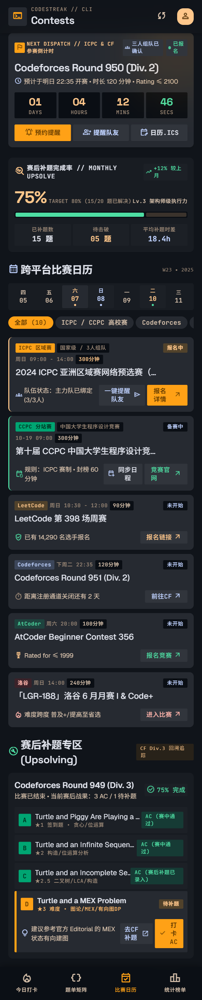

# 比赛日历页（P-03）



> 原型：[code.html](../产品原型/codestreak_3/code.html) · [screen.png](../产品原型/codestreak_3/screen.png)；规范：[组件规范](../02-设计规范/05-组件规范.md) · [弹层与全局状态](06-弹层与全局状态.md) · [设计令牌规范](../02-设计规范/02-设计令牌规范.md)。
> 颜色一律写令牌名（`cs.color.*`）；尺寸单位 vp、字号单位 fp。示例基准时刻：2025-06-07 18:14:50（Asia/Shanghai，周六）。

## 1. 页面目标与信息优先级

| 目标 | 用户问题 | 判定信号 |
| --- | --- | --- |
| G1 不错过比赛 | 下一场是什么、还有多久、在哪报名 | 首屏 1s 内读出赛事名与剩余时间；开启提醒 ≤ 2 次点击 |
| G2 赛前准备 | 队友齐了吗、报名了吗、规则与时长 | 组队／报名／提醒状态在卡片首行可见 |
| G3 赛后补齐 | 这场欠几题、欠哪题、怎么补 | 补题卡可原地打卡，完成率自动回写 |

信息优先级：P0 下一场赛事与倒计时（C-26）→ P1 本月补题完成率（C-27）→ P2 本周赛事与筛选（C-28／C-29）→ P3 赛后补题任务（C-30）。C-26 必须完整落在首屏，不被 C-27 挤出。

## 2. 布局树

```text
P-03 比赛日历（Contests）
└─ ScrollView（padding 16／底部留白 80／区块 gap 20）
   ├─ C-01 AppBar（眉标 "CODESTREAK // CLI" + 标题 "Contests"）
   ├─ C-26 CountdownHUD（CF Round 950 Div.2 · 01/04/20/10）
   ├─ C-27 UpsolveGauge（75% · TARGET 80%）
   ├─ C-03 SectionHeader「跨平台比赛日历」+ 周标 "W23 • 2025"
   ├─ C-28 WeekStrip（四05 / 五06 / 六07 / 日08 / 一09 / 二10 / 三11）
   ├─ 筛选 chips（C-21：全部(10) / ICPC·CCPC 高校赛 / Codeforces / LeetCode / AtCoder / 洛谷）
   ├─ C-29 ContestCard ×6（① ICPC 报名中 ② CCPC 备赛中 ③ LC398 ④ CF951 ⑤ ABC356 ⑥ LGR-188）
   ├─ C-03 SectionHeader「赛后补题专区 (Upsolving)」+ "CF Div.3 回溯追踪"
   └─ C-30 UpsolveTaskCard（CF Round 949：3 AC / 1 待补）
C-02 BottomTabBar（固定底部，选中「比赛日历」）
C-18 Toast（全局浮层，bottom = 64vp + 24vp）
```

## 3. 区块规格

### 3.1 C-01 AppBar

| 项 | 规格 |
| --- | --- |
| 高度 | 56vp + 状态栏安全区；左右 `padding` 16vp；背景 `cs.color.surface`@85% + 模糊，底部 1px 阴影 |
| 眉标 | "CODESTREAK // CLI"，label-sm（10fp/500，字距 0.15em），`cs.color.text.tertiary` |
| 标题 | "Contests"，headline-sm（20fp/600），`cs.color.text.primary` |
| 右侧 | C-11 分享按钮（18vp）+ 32vp 圆形头像，底 `cs.color.primary.container`、图标 `cs.color.primary.on-container` |
| 页面节奏 | 页边距 16vp；顶部距 AppBar 8vp；C-03 图标 20vp + 标题 headline-sm/600（gap 4vp），右侧附加文案 label-sm；卡片圆角 12vp、控件 4vp |

原型 HTML 是 `main` 片段，缺少 `<body>` 与 AppBar 骨架；AppBar 以截图为准，按本节与全局骨架补齐。

### 3.2 C-26 CountdownHUD

| 区域 | 规格与文案 |
| --- | --- |
| 容器 | 圆角 12vp、`padding` 12vp，底 `cs.color.surface.high`，右上角 `cs.color.primary.glow`（仅此一处，不叠加第二光斑） |
| 眉标 | 20vp 琥珀方块（`cs.color.primary.container` + flag 14vp）+"NEXT DISPATCH // ICPC & CF 参赛倒计时"，label-sm/600 `cs.color.primary`，单行省略 |
| 右侧胶囊 | "三人组队已确认"（groups 12vp `cs.color.tertiary`）；"已报名"（2vp 脉冲点 + 文案 `cs.color.secondary`）；底 `cs.color.surface.highest`，圆角 4vp，`padding` 4×2 |
| 标题与元信息 | "Codeforces Round 950 (Div. 2)"，headline-sm/600，最多 2 行；下行 schedule 14vp `cs.color.tertiary` + "预计于明日 22:35 开赛 • 时长 120 分钟 • Rating ≤ 2100"，body-sm `cs.color.text.secondary` |
| 四格 | 4 列等宽、`gap` 4vp；单格底 `cs.color.surface.lowest`、圆角 4vp、`padding` 4vp；数字 headline-sm/700 `tabular-nums`、两位补零（01／04／20／10）；DAYS／HOURS／MINS `cs.color.primary`、SECS `cs.color.secondary`；标签 label-sm `cs.color.text.tertiary`、字距 0.08em |
| 按钮组 | 3 列等宽、`gap` 4vp、高 36vp、圆角 4vp、label-md/600；按压 `translateY(1vp)`；预约提醒（notifications_active，`cs.color.primary.container`／on-container）、提醒队友（group_add，`cs.color.surface.highest`／`cs.color.tertiary`）、日历.ICS（edit_calendar，`cs.color.surface.highest`／`cs.color.text.primary`） |

**计时与状态机**（`start_at` = 06-08 22:35，`end_at` = 06-09 00:35）：

| 状态 | 判定 | 四格 | 眉标尾部 | 主按钮 |
| --- | --- | --- | --- | --- |
| UPCOMING | `now < start_at` | 倒计时，每秒刷新 SECS | 不变 | 预约提醒；已设置时变「已预约提醒 ✓」 |
| LIVE | `start_at ≤ now < end_at` | 正向计时（DAYS 恒 00） | "LIVE // 比赛进行中" + 脉冲点 | 「进入赛题」→ 外链；提醒禁用「已开赛」 |
| ENDED | `now ≥ end_at` | 单行 "已结束 · 共 120 分钟" | "ARCHIVED // 已结束" | 「赛后补题」→ P-08；「查看榜单」→ 外链 |
| ENDED+24h | `now ≥ end_at + 24h` | 整卡移除，由下一条 UPCOMING 接替 | — | — |

- 秒级刷新只驱动 SECS 文本节点；后台／息屏暂停，`onForeground` 以 `start_at - now` 全量重算，避免累积漂移；剩余 ≤ 0 时先切状态再归零，不允许负值或连续多帧 "00/00/00/00"。
- 无下一条 UPCOMING 时该位置渲染 C-39 "本周赛程已收官，去题库保持手感"；`start_at` 缺失或解析失败则整卡不渲染，页面直接从 C-27 起。

### 3.3 C-27 UpsolveGauge

| 区域 | 规格与文案 |
| --- | --- |
| 容器 | 圆角 12vp、`padding` 12vp，底 `cs.color.surface.low`，区块间距 8vp |
| 眉标 | troubleshoot 20vp `cs.color.primary` + "赛后补题完成率 // MONTHLY UPSOLVE"，label-md/600 |
| 增量胶囊 | trending_up 13vp + "+12% 较上月"，label-sm `cs.color.secondary`，底 `cs.color.surface.container`，圆角 4vp |
| 主数值与目标 | "75%" headline-xl-mobile（32fp/700）`cs.color.primary` `tabular-nums`；同行 "TARGET 80% (15/20 题已解决)" label-sm `cs.color.text.tertiary`；"Lv.3 架构师级执行力" label-sm `cs.color.text.secondary` 右对齐 |
| 三小格 | 底 `cs.color.surface.container`、`padding` 4vp、`gap` 4vp；标签 label-sm `cs.color.text.tertiary`，数值 label-lg/700：已补题数 15 题／待击破 05 题（`cs.color.primary`）／平均补题时差 18.4h（`cs.color.tertiary`） |

分段条高 12vp，槽 `cs.color.surface.lowest`，`padding` 2vp、`gap` 4vp、圆角 2vp，按 100% 拆三段以免"75% + 剩余"对不上账：

| 段 | 占比 | 填充 | 语义 |
| --- | --- | --- | --- |
| 已补 | 75% | `cs.color.secondary` | 15/20 已解决 |
| 距目标缺口 | 5% | `cs.color.primary.fixed-dim`@40% | 75% → 80% 的待补额度 |
| 目标外余量 | 20% | `cs.color.primary`@20% | 80% → 100%，即"剩余 20% 琥珀淡色" |

- 完成率 = 统计窗口内已结束赛事的已 AC 题数 ÷ 总题数（15/20）；平均补题时差只对"赛后 AC"题取（AC 时间 − 比赛结束时间）均值，样本 n=4，保留 1 位小数。
- 达标（≥ 80%）后"已补"段改 `cs.color.primary.container`（令牌"指标进度达标"），缺口段 5%→0 并 300ms 淡出；打卡后 15→16、05→04、75%→80%，TARGET 文案变 "(16/20 题已解决)"，Toast 见 4.2。

### 3.4 日历区头与 C-28 WeekStrip

- 区头：calendar_month 20vp `cs.color.tertiary` + "跨平台比赛日历" headline-sm；右侧 "W23 • 2025"，label-sm、等宽、`cs.color.text.tertiary`。
- 周条：7 格等分、高 56vp、底 `cs.color.surface.low`、圆角 8vp、内 `padding` 4vp；单格含星期单字（label-sm）+ 两位日期（label-md）+ 2vp 圆点，纵向居中、间距 2vp；选中态底 `cs.color.surface.high`、文字 `cs.color.primary`、日期 700 字重，未选 `cs.color.text.secondary`；默认选中今天（06-07），点击切换并过滤 C-29，再次点击回到"全部"。
- 圆点：每格最多 1 个，取当日"最近一场未结束赛事"的平台色（`cs.color.platform.*`；CCPC 用 `cs.color.secondary.container`）；当日仅有已结束赛事用 `cs.color.border.subtle` 弱圆点；无赛事不渲染但保留 2vp 占位。
- 跨周边界：周条是滚动 7 日窗（today−2 … today+4），左右滑动或点箭头整周平移，跨周后选中同一 weekday；周标 = 窗口首日所属 ISO 周 + 年份（06-05 → "W23 • 2025"），跨周不合并标注。
- 日期归属统一按 Asia/Shanghai（见 5.1）。

### 3.5 筛选 chips（C-12 / C-21）

- 横向滚动、`gap` 8vp、高 28vp、圆角 full、左右 `padding` 12vp，label-md；选中 `cs.color.primary.container` + `cs.color.primary.on-container` + 600 字重，未选 `cs.color.surface.high` + `cs.color.text.secondary`。
- 选项与计数：`全部 (10)`、高校赛 3、Codeforces 3、LeetCode 1、AtCoder 2、洛谷 1。v1.0 仅"全部"展示计数（全展示会换行），其余计数保留在数据层供选中后的列表标题与空态使用。
- 单选互斥，切换 150ms 底色过渡并让列表回到顶部；计数口径 = W23 窗口内全部赛事（含已结束），与列表行数不等的构成见 6.2。

### 3.6 C-29 ContestCard

| 项 | 规格 |
| --- | --- |
| 容器 | 底 `cs.color.surface.container.high`、圆角 12vp、`padding` 12vp、`gap` 8vp，左侧 2vp 状态竖条（始终占位，避免缩进跳动） |
| 名片头 | 平台徽标 + 元信息 chips，`flex-wrap`、`gap` 4vp；高校赛实心（ICPC `cs.color.primary.container`／on-container，CCPC `cs.color.secondary.container`／on-container），OJ 用平台色@20% 底 + 平台色文本 |
| 元信息 | 时间 label-sm `cs.color.text.tertiary`（等宽数字）+ 时长 chip（底 `cs.color.surface.lowest`、圆角 4vp、`padding` 4×2）；报名中／备赛中数字 `cs.color.text.primary`，未开始 `cs.color.text.secondary` |
| 标题与页脚 | 标题 body-lg/500 单行省略；胶囊右对齐、高 20vp、圆角 4vp、label-sm/600；页脚左：15vp 前导图标 + body-sm `cs.color.text.secondary`，右：1–2 个操作（高 28vp、圆角 4vp、label-md），次按钮 `cs.color.surface.highest`、主按钮 `cs.color.primary.container` |

| 状态 | 判定 | 左竖条 | 胶囊 | 主操作 |
| --- | --- | --- | --- | --- |
| 报名中 | 报名窗口开启且未报名 | `cs.color.primary.container` | "报名中" `cs.color.primary`／`cs.color.primary`@20% | 实心琥珀（报名详情） |
| 备赛中 | 已报名或已组队，距开赛 ≤ 7 天 | `cs.color.secondary.container` | "备赛中" `cs.color.secondary`／@20% | 次按钮 + 实心官网入口 |
| 未开始 | 未开放报名或无报名概念 | 无（透明占位） | "未开始" `cs.color.text.tertiary`／`cs.color.surface.lowest` | 平台色文字次按钮 |
| 进行中／已结束（规划） | `start ≤ now` 为进行中，`now ≥ end` 为已结束 | `cs.color.secondary` + 2vp 脉冲／`cs.color.border.subtle` | "进行中" `cs.color.secondary`／"已结束" `cs.color.text.tertiary` | "进入赛题"（平台色实心）／"赛后补题"（次按钮） |

状态优先级：进行中 > 报名中（未报名）> 备赛中 > 未开始 > 已结束；"已组队但未提交报名"仍显示报名中；已结束赛事 v1.0 不在列表渲染，只计入 chip 计数。

| # | 徽标 + 类型 chip | 元信息 | 标题 | 胶囊 | 页脚说明 | 操作 |
| --- | --- | --- | --- | --- | --- | --- |
| ① | ICPC 区域赛 + 国家级／3 人组队 | 明日 09:00 - 14:00 · 300 分钟 | 2024 ICPC 亚洲区域赛网络预选赛（第一场） | 报名中 | 队伍状态：主力队已绑定 (3/3 人) | 一键提醒队友／报名详情 |
| ② | CCPC 分站赛 + 中国大学生程序设计竞赛 | 下周三 09:00 · 300 分钟 | 第十届 CCPC 中国大学生程序设计竞赛（绵阳站）网络赛 | 备赛中 | 规则：ICPC 赛制 · 封榜 60 分钟 | 同步日程／竞赛官网 |
| ③ | LeetCode | 明日 10:30 - 12:00 · 90 分钟 | LeetCode 第 398 场周赛 | 未开始 | 已有 14,290 名选手报名 | 报名链接 |
| ④ | Codeforces | 下周二 22:35 · 120 分钟 | Codeforces Round 951 (Div. 2) | 未开始 | 距离注册通道关闭还有 2 天 | 前往 CF |
| ⑤ | AtCoder | 今日 20:00 · 100 分钟 | AtCoder Beginner Contest 356 | 未开始 | Rated for ≤ 1999 | 报名竞赛 |
| ⑥ | 洛谷 | 明日 14:00 · 240 分钟 | 「LGR-188」洛谷 6 月月赛 I & Code+ | 未开始 | 难度跨度 普及+／提高至省选 | 进入比赛 |

> 时间文案按 5.2 由事件时间派生，不写死。原型 ② 卡写 "10-19 09:00"、⑤ 卡写 "周六 20:00"，与 W23 窗口／相对时间规则冲突，示例分别裁定为 06-11（周三）与今日 20:00。

### 3.7 C-30 UpsolveTaskCard

| 区域 | 规格与文案 |
| --- | --- |
| 容器 | 底 `cs.color.surface.low`、圆角 12vp、`padding` 12vp、`gap` 12vp |
| 标题行 | 标题 body-lg/600；副行 "比赛已结束 • 当前赛后战果：3 AC / 1 待补题" body-sm `cs.color.text.secondary`；右侧 "75% 完成" 胶囊（check_circle 16vp，`cs.color.secondary`，底 `cs.color.surface.container`） |
| 题目行 | 高 40vp、`padding` 8vp、底 `cs.color.surface.container`、圆角 4vp；字母块 24vp（`cs.color.secondary.container`／on-container）；题名 body-md；元信息 label-sm `cs.color.text.tertiary`；右侧 AC 胶囊 `cs.color.secondary`／@20% |
| D 行（重点） | 底 `cs.color.surface.high`，左 4vp `cs.color.primary.container` 竖条；字母块与胶囊 `cs.color.primary` 系；元信息 `cs.color.primary.fixed-dim`；提示行 lightbulb + "建议参考官方 Editorial 的 MEX 状态有向建图"；操作 "去CF补题"（次，`cs.color.tertiary`）／"打卡AC"（主） |

| 题 | 题名 | 元信息 | 状态胶囊 |
| --- | --- | --- | --- |
| A | Turtle and Piggy Are Playing a Game | ★1 签到题 · 贪心／位运算 | AC (赛中通过) |
| B | Turtle and an Infinite Sequence | ★2 构造／位运算分析 | AC (赛中通过) |
| C | Turtle and an Incomplete Sequence | ★2.5 二叉树／LCA／构造 | AC (赛后补题已录入) |
| D | Turtle and a MEX Problem | ★3 难度 · 图论／MEX／有向图DP | 待补题 |

- 打卡后：D 行转 AC 样式（竖条与字母块改 `cs.color.secondary.container`、胶囊 "AC (赛后补题已录入)"），提示行替换为 "已录入补题日志 · 计入本月完成率"，按钮变 "已打卡 AC"（`cs.color.secondary.container`）并可长按 2s 撤销；头部 75%→100%、战果 "4 AC / 0 待补题"，C-27 按 3.3 联动。
- 幂等：以 `(contest_id, problem_index)` 去重，重复提交只回显成功不递增；失败入本地重试队列，恢复网络后补提交并校准完成率。

## 4. 交互规格

### 4.1 关键动作

| 动作 | 流程 | 失败／边界 |
| --- | --- | --- |
| 预约提醒 | 检查通知权限 → 写本地双提醒（开赛前 15 分钟、开赛时刻）→ 服务端订阅 → 按钮变「已预约提醒 ✓」 | 权限拒绝弹 C-17 引导去系统设置；已订阅再点即取消并 Toast |
| 日历.ICS | 本地生成 VEVENT（UID=`contest-<id>@codestreak`、`DTSTART;TZID=Asia/Shanghai`、`DURATION:PT120M`、`SUMMARY`、`URL`、`VALARM:-PT15M`）→ 系统日历写入 | 无日历应用或写入拒绝 → Toast "导出失败：未找到可用的日历应用" |
| 提醒队友 | 拉起系统分享，文本 "【CodeStreak】ICPC 网络预选赛第一场 6/8 09:00 开赛，队伍已确认 3/3，请提前 15 分钟上线调试环境。" | 离线 → Toast "当前离线，提醒将在联网后发送" |
| 外链与卡片 | 报名／官网走系统浏览器，返回 `onPageShow` 单场刷新；点标题进 P-07（规划） | P-07 未上线时仅按钮可点；打开失败 Toast |
| 补题打卡 | 见 3.7，成功后本地即时回写 C-27 与 C-30 | 重复点击幂等；长按 2s 撤销 |

### 4.2 Toast 文案表（C-18）

Toast 底 `cs.color.surface.inverse`、文 `cs.color.text.inverse`、圆角 8vp、`padding` 12×8、图标 18vp `cs.color.secondary`；宽为屏宽 − 32vp，展示 2.5s，同一时刻仅 1 条（后到覆盖），切页立即消失，不拦截点击。

| 文案 | 触发 | 图标 |
| --- | --- | --- |
| 已开启 CF Round 950 赛前 15 分钟推送提醒 | 预约成功 | notifications_active |
| 已取消该赛事的提醒 | 取消预约 | notifications_off |
| 已将赛事日历 (.ics) 同步至系统日程表 | ICS 成功 | event_available |
| 已向队员发出 ICPC 赛程确认与组队提醒 | 分享返回成功 | send |
| D 题补题记录已同步，本月完成率升至 80% | 打卡成功 | task_alt |
| 赛历已更新 · 19:42 | 下拉刷新成功 | sync |
| 网络异常，已展示 19:42 的缓存赛历 | 刷新失败 | cloud_off |

### 4.3 刷新与滚动

- 下拉刷新阈值 64vp，松手触发，最多 1 次 feed 请求、超时 3s；成功 Toast，失败保留旧数据。自动刷新时机：冷启动、前台恢复且距上次 > 30 min、每日 06:00，报名截止前 24h 的赛事每 15 min 轮询（v1.1）；首屏用 C-40 骨架 300ms，不闪空态。
- 滚动位置：Tab 切换与从 P-07／P-08 返回均保留 offset；切换筛选或周条后列表回顶；冷启动不恢复。

### 4.4 状态矩阵

| 场景 | C-26 | C-27 | C-28／筛选 | C-29 |
| --- | --- | --- | --- | --- |
| 未来 7 天无赛事 | C-39 "本周赛程已收官…" | 正常 | 全部 (0)，其余 0 | C-39 "暂无赛事" |
| 全部已结束 | 下一条 UPCOMING 接替，无则 C-39 | 正常 | 圆点全为弱色 | C-39 + "查看已结束 3 场"（规划） |
| 提醒已设置 | 主按钮「已预约提醒 ✓」（`cs.color.surface.highest` + `cs.color.secondary`） | — | — | — |
| 已在报名／已组队 | 胶囊「已报名」 | — | — | 对应卡转「备赛中」 |
| 网络失败 | 保留缓存 + 卡片顶部 8vp 提示条 "数据可能过期" | 缓存 | 缓存 | 缓存 |
| 时区变化／未登录 | 相对时间与倒计时重算；未登录整页 C-39 "登录后查看赛历" | 隐藏 | 隐藏 | 隐藏 |

## 5. 时间与本地化规则

### 5.1 时区

- 存储 UTC 时间戳 + 原始赛区时区；时间点按**设备时区**渲染，设备非 Asia/Shanghai 时 C-26 元信息尾部追加 "（北京时间 22:35）"；日期归属（今天／明天／周X、周条分格、日筛选）统一按 **Asia/Shanghai 00:00** 切日，与 P-04 统计口径一致。
- 系统时区变更只重算文案与周条，不重新请求；设备时间与服务端偏差 > 60s 时以服务端为准并 Toast "设备时间异常，已按服务器时间校正"。

### 5.2 相对时间文案

| 条件 | 文案 | 示例 |
| --- | --- | --- |
| 目标日 = 今天 / 明天 | 今日 HH:mm ／ 明日 HH:mm | 今日 20:00 ／ 明日 22:35 |
| 落在今天所在 ISO 周 | 周X HH:mm | 周日 09:00 |
| 落在下一 ISO 周 | 下周X HH:mm | 下周二 22:35 |
| 其他 / 跨年 | MM-DD HH:mm ／ YYYY-MM-DD HH:mm | 06-19 09:00 ／ 2026-01-04 22:35 |

按行序匹配（"明天"优先于"同一 ISO 周"）；跨日 00:00 与前台恢复时重算；周条选中非今日日期不改变列表内文案，只在列表标题追加 "· 06-08"。

## 6. 数据来源

### 6.1 实体与接口

- `contest_feed`：id、platform、external_id、title、start_at(UTC)、duration_min、tz_origin、rating_limit、register_deadline、state、url、updated_at（多平台聚合，服务端去重排序）。
- `user_contest_state`：contest_id、register_state(none/registered/teamed)、team_id、team_size、remind_at、ics_exported_at（决定卡片状态与胶囊）。
- `upsolve_record`：contest_id、problem_index、verdict、ac_at、source(in_contest/upsolve)、editorial_hint（驱动 C-30 与完成率）。
- 接口：`GET /v1/contests?from&to&tz=Asia/Shanghai`、`POST /v1/contests/{id}/remind`、`POST /v1/upsolve/{contest}/{index}`（`DELETE` 撤销），预约与打卡均带幂等键。

### 6.2 W23 示例数据（10 场）

窗口 06-05 至 06-11（滚动 7 日窗），共 10 场；下表列出 8 场，另 2 场已结束赛事只参与计数：

| 日期（上海） | 平台 | 赛事 | 时长 | 状态 | 页面位置 |
| --- | --- | --- | --- | --- | --- |
| 06-05 22:35 | Codeforces | Round 949 (Div. 3) | 120 | 已结束 | 仅计数（→ C-30） |
| 06-07 20:00 | AtCoder | ABC 356 | 100 | 未开始 | C-29 ⑤ |
| 06-08 09:00 | ICPC | 亚洲区域赛网络预选赛（第一场） | 300 | 报名中 | C-29 ① |
| 06-08 10:30 | LeetCode | 第 398 场周赛 | 90 | 未开始 | C-29 ③ |
| 06-08 14:00 | 洛谷 | LGR-188 月赛 I & Code+ | 240 | 未开始 | C-29 ⑥ |
| 06-08 22:35 | Codeforces | Round 950 (Div. 2) | 120 | 已报名 | C-26（列表不重复） |
| 06-10 22:35 | Codeforces | Round 951 (Div. 2) | 120 | 未开始 | C-29 ④ |
| 06-11 09:00 | CCPC | 绵阳站网络赛 | 300 | 备赛中 | C-29 ② |

计数关系：`全部 (10)` = 6 张列表卡 + 1 张 C-26 已聚焦赛事 + 3 场已结束（含未列出的 06-06 ICPC 西安邀请赛与 AGC 067）；平台计数 高校赛 3／Codeforces 3／LeetCode 1／AtCoder 2／洛谷 1。

### 6.3 埋点

| 事件 | 触发 | 参数 |
| --- | --- | --- |
| `contest_page_view` | 进入 Tab | tab_from |
| `contest_filter_select` / `contest_week_select` | 点 chip／周条 | filter、date、count |
| `contest_card_open` | 点卡片 | contest_id、platform、state |
| `contest_remind_toggle` | 预约／取消 | contest_id、on |
| `contest_ics_export` / `contest_team_share` | 导出／提醒队友 | contest_id、result |
| `upsolve_mark` | 打卡／撤销 | contest_id、problem_index、result |

## 7. 验收清单

1. C-26 在 6.7 寸竖屏首屏完整可见（含三按钮），不因 C-27 挤压被截断。
2. 倒计时 01/04/20/10 与"明日 22:35"在同一基准时刻可复算一致；SECS 每秒 −1，无跳秒／负值。
3. `start_at` 到达 1s 内切 LIVE，`end_at` 到达切 ENDED，24h 后 C-26 让位下一条赛事。
4. 预约提醒写入 2 条通知；权限拒绝出现 C-17 引导；取消后按钮复原。
5. ICS 在系统日历生成单个日程，含 −15 分钟提醒，时区 Asia/Shanghai。
6. 筛选单选互斥，"全部 (10)" 与 6.2 计数一致；切换后列表回顶。
7. 六张卡的状态竖条、胶囊、主操作与状态表一致；"已组队未报名"显示报名中。
8. 周条默认选中今天；切换日期后只保留该日赛事，再次点击回到全部。
9. D 题打卡后 D 行转 AC、头部 100%、C-27 变 80%（缺口段消失）并出现对应 Toast。
10. 重复点击打卡不重复计数；断网打卡进入重试队列并在恢复后校准。
11. 刷新失败展示缓存并出现"数据可能过期"提示条，不出现空白页。
12. 设备时区切到 UTC+0 后追加北京时间，日期归属仍按上海切日；Tab 切换保留滚动位置。

## 8. 变更记录

| 版本 | 日期 | 变更 | 作者 |
| --- | --- | --- | --- |
| v1.0 | 2026-10-26 | 首版：确立 C-26 倒计时状态机、C-27 三段式完成率、C-29 五态卡、C-30 打卡联动与 W23 数据口径 | 交互设计组 |
