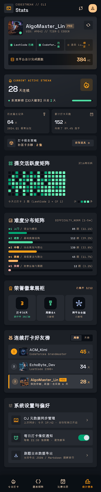

# 统计榜单页（P-04）



> 原型：[code.html](../产品原型/codestreak_4/code.html) · [screen.png](../产品原型/codestreak_4/screen.png)；规范：[组件规范](../02-设计规范/05-组件规范.md) · [弹层与全局状态](06-弹层与全局状态.md) · [设计令牌规范](../02-设计规范/02-设计令牌规范.md)。
> 颜色一律写令牌名（`cs.color.*`）；尺寸单位 vp，字号单位 fp。本页同时是设置入口，P-10 为设置全量页、本页保留三行内嵌入口。

## 1. 页面目标与信息优先级

| 目标 | 用户问题 | 判定信号 |
| --- | --- | --- |
| G1 自我证明 | 我坚持了多久、总量多少、达到什么等级 | 首屏读完"28 天 / 384 AC / 152 天"三个数 |
| G2 趋势洞察 | 最近有没有变懒、难点在哪 | 热力图与难度分布无需跳转即可读趋势 |
| G3 社交位置 | 我在好友里排第几、差多少 | 榜单 2s 内定位到 YOU 行与差距天数 |

信息优先级：P0 身份与总量（C-31）→ P1 连续与里程碑（C-04／C-37／C-38）→ P2 趋势（C-32／C-33）→ P3 荣誉与社交（C-34／C-35）→ P4 设置（C-36）。里程碑（距 30 天徽章还差 2 天）必须出现在首屏，驱动次日回访。

## 2. 布局树

```text
P-04 统计榜单（Stats）
└─ ScrollView（padding: 16 16 80 16，gap 16）
   ├─ C-01 AppBar（眉标 "CODESTREAK // CLI" + 标题 "Stats"）
   ├─ C-31 ProfileCard
   │  ├─ 头像 56 + 在线点 / AlgoMaster_Lin + PRO / UID #9042 // TIER-1 CODER
   │  ├─ C-11 同步按钮（cached 18vp）
   │  ├─ 平台徽章 ×3（LeetCode 已连 / Codeforces 已连 / 洛谷 Luogu 绑定→）
   │  └─ 全平台总计完成题数 384 AC
   ├─ C-04 StreakHeroCard variant="hud"
   ├─ Row（C-37 ×2：历史最长 64 天 / 累计打卡 152 天）
   ├─ C-38 MakeupCard（打卡保全策略 · 余额 2 张）
   ├─ C-32 HeatmapMatrix（近 16 周 + 五档图例 + 今日摘要）
   ├─ C-33 DifficultyDistribution（★1..★5）
   ├─ C-34 BadgeShelf（3/12）
   ├─ C-35 Leaderboard（周榜/月榜）
   ├─ C-36 SettingsRow ×3（同步管理 / 每日提醒 / 数据导出）
   └─ C-02 BottomTabBar（固定，选中「统计榜单」）
```

## 3. 区块规格

### 3.1 C-01 AppBar 与页面节奏

| 项 | 规格 |
| --- | --- |
| AppBar | 高 56vp + 安全区，左右 16vp；眉标 "CODESTREAK // CLI" label-sm/500 字距 0.15em `cs.color.text.tertiary`；标题 "Stats" headline-sm/600 `cs.color.text.primary`；右侧分享 + 32vp 头像按钮（底 `cs.color.primary.container`） |
| 页边距 | 左右 16vp；顶部距 AppBar 8vp；底部滚动留白 64vp + 24vp；区块 `gap` 16vp |
| 卡片圆角 | 12vp；行项目 8vp；图标块 8–12vp；胶囊 4vp |
| 区块头 | 18vp 图标（`cs.color.primary`／`cs.color.secondary`／`cs.color.primary.container`）+ headline-sm/600 标题 + 右侧 label-sm `cs.color.text.tertiary` 附加文案；自身无外边距 |

### 3.2 C-31 ProfileCard

| 区域 | 规格与文案 |
| --- | --- |
| 容器 | 底 `cs.color.surface.high`，圆角 12vp，`padding` 16vp；右下 1vp `cs.color.border.subtle` 内描边提亮（原型光晕不采纳，令牌仅允许三处光晕） |
| 头像 | 56vp 圆角 12vp；右下 10vp 在线点 `cs.color.secondary` + 2vp `cs.color.surface.high` 描边环 |
| 身份 | "AlgoMaster_Lin"（headline-sm/600，单行省略）+ "PRO" 胶囊（label-sm，`cs.color.primary`／`cs.color.primary`@20%，圆角 4vp）；下行 "UID: #9042 // TIER-1 CODER" label-sm `cs.color.text.tertiary`，字距 0.1em |
| 同步按钮 | 32vp 圆角 8vp，底 `cs.color.surface.container`，cached 18vp `cs.color.text.secondary`；按压 scale 0.95，同步中旋转（见第 5 节） |
| 平台徽章 | 3 列等分、`gap` 4vp，单格底 `cs.color.surface.low`、圆角 8vp、`padding` 8vp；2vp 圆点 + 平台名 label-sm + 状态 label-sm/600 |
| 已连接／未绑定 | 已连：2vp 圆点 `cs.color.secondary` + 6vp 外发光，状态 "已连" `cs.color.secondary`；未绑定：圆点 `cs.color.border.subtle`，名称 `cs.color.text.tertiary`，状态 "绑定→" `cs.color.primary.container`，整格可点（→ P-09） |
| 总量条 | 底 `cs.color.surface.lowest`@80%，圆角 8vp，`padding` 8vp；code_blocks 16vp `cs.color.primary.container` + "全平台总计完成题数" body-sm `cs.color.text.secondary`；右侧 "384" headline-sm/700 `cs.color.primary` + "AC" label-sm `cs.color.text.tertiary` |

平台文案固定为 "LeetCode 已连"、"Codeforces 已连"、"洛谷 Luogu 绑定→"；三列在 360vp 宽下名称允许单行省略，完整名写入无障碍标签。

### 3.3 C-04 StreakHeroCard（variant="hud"）与 C-37

| 区域 | 规格与文案 |
| --- | --- |
| 容器 | 底为 `cs.color.surface.high` → `cs.color.surface.container` 的 135° 渐变，圆角 12vp，`padding` 16vp，`cs.color.primary.glow` 左上光斑 |
| 眉标 | local_fire_department 16vp + "CURRENT ACTIVE STREAK"，label-sm/600 字距 0.15em，`cs.color.primary.container` |
| 主数值 | "28" headline-xl-mobile（32fp/800）`cs.color.text.primary` `tabular-nums` + "天连续" body-md `cs.color.text.secondary` |
| 火焰块 | 48vp 圆角 12vp，底 `cs.color.primary`@15%，图标 30vp 实心 `cs.color.primary.container` |
| 里程碑行 | 2vp 圆点 `cs.color.secondary` + "距离解锁【30天徽章】还差 2 天" body-sm `cs.color.text.secondary`（数字 "2" label-md/600 `cs.color.secondary`）+ 80×6vp 进度条（槽 `cs.color.surface.lowest`，填充 93.3% `cs.color.secondary`） |
| C-37 网格 | 2 列等分、`gap` 8vp；单卡底 `cs.color.surface.container`、圆角 12vp、`padding` 12vp、最小高 96vp |
| C-37 结构 | 顶部 label-sm `cs.color.text.tertiary` + 16vp 图标；数值 headline-sm/700 + 单位 label-sm；备注 label-sm `cs.color.text.tertiary` |
| 左卡 | "历史最长记录" + "64" + "天" + "2024.Q1 极客远征" |
| 右卡 | "累计打卡天数" + "152" + "天" + "击败了 89.4% 选手" |

### 3.4 C-38 MakeupCard

底 `cs.color.surface.low`，圆角 12vp，`padding` 12vp；左侧 32vp 图标块（底 `cs.color.surface.high`，token 18vp `cs.color.primary.fixed-dim`）+ "打卡保全策略" label-md `cs.color.text.primary` + "补签卡余额：2 张"（2 为 `cs.color.primary`/600，其余 body-sm `cs.color.text.secondary`）；右侧 "获取道具 +" 按钮（高 28vp、圆角 8vp，底 `cs.color.surface.high`、文 `cs.color.primary`）。点击余额区 → P-11 补签卡说明（规划）；点击获取道具 → C-17 获取方式面板。

### 3.5 C-32 HeatmapMatrix

| 项 | 规格 |
| --- | --- |
| 容器 | 底 `cs.color.surface.container`，圆角 12vp，`padding` 16vp，`gap` 8vp |
| 区块头 | grid_view 18vp `cs.color.secondary` + "提交活跃度矩阵" headline-sm；右侧 "近16周活跃" label-sm `cs.color.text.tertiary` |
| 矩阵 | 7 行 × 16 列 = 112 格；格 10×10vp、圆角 2vp、间距 2vp；单列 `gap` 2vp；横向滚动，默认滚至最右使今日可见 |
| 对齐 | 第 1 行 = 周一；首列不足 7 天时从周一起排、顶部空槽不渲染；末列今日之后的未来槽不渲染 |
| 今日格 | 无论档位，额外 1vp `cs.color.primary.container` 描边（外扩 1vp），用于定位当天 |
| 交互 | 点击或长按 ≥ 300ms 打开 C-17：`06-07（周六）· 3 题`，平台拆分 `LeetCode 2 · Codeforces 1`，附当日最早／最晚提交时间；空日显示 "无提交记录" |
| 图例 | 左："今天已打卡 3 题 (LeetCode 2 + CF 1)" label-sm `cs.color.text.tertiary`；右："少 → 5 格色阶 → 多"，5 格依次为五档填充色 |
| 空态 | 近 16 周无任何记录 → 矩阵替换为 C-39 "完成首次打卡后点亮矩阵" |

五档阈值（与令牌规范 8.1 一致）：0 → `cs.color.surface.lowest`；1–2 → `cs.color.secondary.container`；3–5 → `cs.color.secondary`；6–8 → `cs.color.secondary.fixed`；≥9 → `cs.color.secondary.fixed` + 6vp 发光 + 1vp 描边。

### 3.6 C-33 DifficultyDistribution

| 档 | 名称／语义 | 题数 | 占比 | 条填充 | 标签色 |
| --- | --- | --- | --- | --- | --- |
| ★1 | 入门／语法与模拟 | 85 | 22.1% | `cs.color.secondary.container` | `cs.color.difficulty.1` |
| ★2 | 基础／基础数据结构 | 112 | 29.2% | `cs.color.secondary` | `cs.color.difficulty.2` |
| ★3 | 进阶／动态规划与图论 | 130 | 33.9% | `cs.color.primary.container` | `cs.color.difficulty.3` |
| ★4 | 困难／高级算法与数论 | 45 | 11.7% | `cs.color.primary.fixed-dim` | `cs.color.difficulty.4` |
| ★5 | 挑战／竞赛压轴与黑题 | 12 | 3.1% | `cs.color.error` | `cs.color.difficulty.5` |
| 合计 | — | 384 | 100.0% | — | — |

- 容器底 `cs.color.surface.container`，圆角 12vp，`padding` 16vp，行 `gap` 10vp；标题行左侧 `★N 名称` label-sm/600 + "／语义" label-sm `cs.color.text.tertiary`，右侧 "85 题 (22.1%)"（题数 `cs.color.text.primary`/600，占比 `cs.color.text.tertiary`）。
- 进度槽高 6vp、`cs.color.surface.lowest`、圆角 full；填充宽度 = 服务端下发的 `percent`（不是 count／max），保留 1 位小数。
- 占比 < 5% 的条不内嵌文字，仅保留右侧数字，避免 3.1% 的条被文字吃掉。

### 3.7 C-34 BadgeShelf

容器底 `cs.color.surface.container`，圆角 12vp，`padding` 16vp，`gap` 12vp；区块头 workspace_premium 18vp `cs.color.primary.container` + "荣誉徽章展柜"，右侧 "已解锁 3/12" label-sm `cs.color.primary`。网格 3 列、`gap` 4vp；单卡底 `cs.color.surface.high`、圆角 12vp、`padding` 8vp、最小高 88vp，内容居中：48vp 圆（底 `cs.color.surface.lowest`）+ 24vp 图标 + 标题 label-sm/600（单行省略）+ 状态 label-sm。

| 态 | 图标色 | 卡片处理 | 状态文案 | 交互 |
| --- | --- | --- | --- | --- |
| 已解锁 | `cs.color.secondary`／`cs.color.primary.container`／`cs.color.tertiary` | 正常 | "已解锁" `cs.color.text.tertiary` | 点击 → P-11 徽章详情 |
| 进行中 | `cs.color.primary.container` | `cs.color.primary`@25% 的 1vp 描边 | "进行中 28/30" `cs.color.secondary` | 点击 → P-11 进度 |
| 锁定 | `cs.color.text.ghost`（仅装饰） | 整卡 60% 不透明度，状态文案不衰减 | "未解锁" `cs.color.text.tertiary` + 右上 12vp 锁形图标 | 点击 Toast "达成 30 天连续打卡后解锁" |

本页三张：打卡30天（进行中 28/30，timer_3）、周赛全A（已解锁，military_tech）、跨平台全能（已解锁，hub）。

### 3.8 C-35 Leaderboard

| 项 | 规格 |
| --- | --- |
| 容器 | 底 `cs.color.surface.container`，圆角 12vp，`padding` 16vp，`gap` 12vp |
| 区块头 | social_leaderboard 18vp `cs.color.primary` + "连续打卡好友榜" headline-sm |
| 切换 | C-19，底 `cs.color.surface.lowest`、`padding` 1vp、圆角 8vp；选中 "周榜"（或"月榜"）底 `cs.color.surface.high` + `cs.color.primary`/600，未选 `cs.color.text.tertiary`；切换 200ms 淡入 |
| 行 | 高 48vp，圆角 8vp，`padding` 10×8；第 1–2 名底 `cs.color.surface.high`，本人底 `cs.color.surface.bright` + 左 2vp `cs.color.primary.container` 竖条（令牌 8.3） |
| 名次徽记 | 24vp 圆形，label-sm/700；1 → `cs.color.primary.container`／`cs.color.primary.on-container`；2 → `cs.color.surface.bright`／`cs.color.text.primary`；3（本人）→ `cs.color.primary`@20%／`cs.color.primary` |
| 头像 | 32vp 圆角 8vp；无头像用昵称首字母，底 `cs.color.surface.container` |
| 文本 | 昵称 body-md/500；副文案 label-sm `cs.color.text.tertiary`；本人昵称 `cs.color.primary`/600 + "YOU" 胶囊（10fp，`cs.color.primary.container`／`cs.color.primary.on-container`） |
| 数值 | headline-sm/700 + "天" label-sm；本人数值 `cs.color.primary` |

示例数据（周榜与月榜同批用户，口径见 4.6）：① ACM_Kimi 45 天（Codeforces Grandmaster）② EchoByte_Dev 34 天（LeetCode 2380+）③ AlgoMaster_Lin 28 天（本人，副文案 "保持冲刺，距前一名仅差 6 天"）。v1.0 仅展示前 3；本人不在前 3 时第 4 行追加本人行并显示真实名次。

### 3.9 C-36 SettingsRow 与 C-02

容器底 `cs.color.surface.container`，圆角 12vp，`padding` 16vp，`gap` 8vp；区块头 tune 18vp `cs.color.text.tertiary` + "系统设置与偏好"。行高 52vp、底 `cs.color.surface.high`、圆角 8vp、`padding` 12vp；图标块 36vp 圆角 8vp（底 `cs.color.surface.container`，图标 20vp）；标题 body-md、副文案 label-sm `cs.color.text.tertiary` 单行省略；右侧 chevron 18vp 或 Toggle 44×24vp（开 `cs.color.secondary.container`，关 `cs.color.surface.lowest`，旋钮 20vp `cs.color.text.primary`）。

| 行 | 图标／色 | 标题 | 副文案 | 右侧 |
| --- | --- | --- | --- | --- |
| 1 | sync_saved_locally `cs.color.primary.container` | OJ 元数据同步管理 | 上次同步: 今天 19:42 · 自动轮询已开启 | chevron → P-10 |
| 2 | alarm `cs.color.secondary` | 每日打卡催促通知 | 每晚 21:30 强提醒 · 避免断签 | Toggle（默认开） |
| 3 | file_download `cs.color.tertiary` | 刷题日志数据导出 | 支持导出 JSON / Markdown 题解索引 | chevron → P-12 |

C-02 与其他 Tab 一致：高 64vp + 安全区，选中「统计榜单」为 `cs.color.primary.container`。

## 4. 数据口径

### 4.1 连续天数与断签

- 打卡（达标）= 当日（Asia/Shanghai 00:00–23:59:59）`daily_target_progress ≥ daily_target`（两张目标卡各计 1，目标 2）；仅 1 题 AC 只是 `daily_ac_count` 增加，不算达标。
- `streak_current` = 若今日已达标，从今日向前连续达标的天数；若今日未达标，从昨日向前连续的天数（今日未结束不算断签）。当前 28 天 = 05-11 至 06-07。
- 断签判定：跨过 24:00 仍未达标 → `streak_current` 归零；次日再达标从 1 重新计，并把断签前的值写入 `streak_best` 比较。历史最长 64 天为 2024.Q1 的记录，不随断签回退。
- 补签：断签后 48h 内可消耗 1 张补签卡补 1 天，当日状态改判 `makeup`，`streak_current` 恢复为断签前值并 +1，累计打卡天数同步 +1；不可连续补 2 天。补签日计入连续序列，因此**可**刷新历史最长（与 `streak_current` 口径一致）。

### 4.2 累计天数与击败百分比

- 累计打卡天数 = 历史上"达标或补签"的自然日去重计数（含补签日），当前 152 天；与 384 AC 无换算关系。
- 击败百分比 = 全站样本（近 90 天有 ≥ 1 次 AC 的活跃用户）中**累计打卡天数严格小于**本人者所占比例，保留 1 位小数；本人 89.4%。样本 < 1000 时显示 "—"，不展示分位。
- 分位与榜单名次相互独立：前者是全站样本，后者是好友圈层，禁止互相推导。

### 4.3 热力图

- 窗口固定近 16 周（112 个自然日，示例 02-16 至 06-07），末日 = 今日；按 Asia/Shanghai 归日，不受设备时区影响。
- 每日计数 = 当日去重后 AC 题数；五档阈值见 3.5；今日 3 题落第 2 档（3–5）。
- 平台拆分 "LeetCode 2 + CF 1" 按题目**首次 AC 平台**归属，跨平台同题只计一次。

### 4.4 难度分布

- 分母 = 去重后已 AC 题数 384；按 `difficulty_norm` 归档，0.5 星向下取档（★2.5 → ★2 档）。
- `percent` 由服务端按精确四舍五入下发并校验合计 100.0%（22.1／29.2／33.9／11.7／3.1），客户端只展示不重算，避免端侧四舍五入出现 99.9／100.1。
- 计数与占比的 ±0.1pp 舍入差由服务端吸收；验收以表中固定值为准。

### 4.5 时区、跨平台去重

- 统计口径固定 Asia/Shanghai（UTC+8）；跨时区用户的"今天"仍是上海今天，日期明细（C-17）与"数据截至"文案统一标注"北京时间"。
- `problem_key = (normalized_oj, normalized_problem_id)`；跨平台同题按 OJ 元数据映射表归一，只计 1 次；映射失败按平台内独立计并打标 `dedup=unknown`，不参与"跨平台全能"徽章判定。
- 赛中 AC 与赛后补题 AC 均计入 384，同一题只计一次；删除／撤回的记录在次日 00:00 重算窗口内生效。

### 4.6 榜单

- 指标恒为**当前连续打卡天数**，周榜／月榜是榜单的结算周期，不是"周内／月内打卡天数"，因此不存在 7 天／31 天上限。
- 周榜：每周一 00:00 结算（入榜资格为最近 7 天有打卡）；月榜：每月 1 日结算（资格为本月有打卡）。结算只重置名次与徽记，不清零天数。
- 同分 tie-break：最近 24h AC 数降序 → UID 升序；本人高亮按 `uid` 匹配，不按昵称。
- 示例两榜三甲同为 45／34／28（同一批好友的连续天数，差异在周期与资格）；"距前一名仅差 6 天" = 34 − 28。

### 4.7 接口与缓存

| 接口 | 关键字段 | 缓存与读取策略 |
| --- | --- | --- |
| `GET /v1/stats/summary` | ac_total、streak_current、streak_best、checkin_days、beat_percent、badges_unlocked／total、updated_at；heatmap（112 日 count／platform_breakdown／tier）随同批下发 | 本地缓存 24h；命中缓存时 C-31 追加 "数据截至 …"；按日增量合并，不覆盖历史日 |
| `GET /v1/stats/difficulty` | star、count、percent（服务端配平）、total | 只读，客户端不重算 |
| `GET /v1/leaderboard`（period=week／month） | rank、uid、nickname、avatar、streak、sub_label | 两榜一次返回，切换不重新请求 |
| `POST /v1/sync` / `PATCH /v1/settings` | platforms、reminder_enabled | 同步超时 10s，按钮全程 disabled |

## 5. 交互规格

| 动作 | 流程 | 失败／边界 |
| --- | --- | --- |
| 同步数据 | 图标 1.2s 线性 360° 旋转 + 按钮 disabled；并行拉取已连平台（跳过未绑定的洛谷），刷新 C-31／C-04／C-32／C-33／C-34 | 成功 Toast "已同步 2 个平台 · 19:42"；单平台超时 Toast "同步失败：Codeforces 超时，已保留 19:42 数据"；离线 Toast "当前离线，展示本地缓存（19:42）" |
| 平台绑定 | 洛谷格 → P-09（`platform=luogu`）；已连格 → P-09 平台详情；长按格 → Toast "上次同步 今天 19:42" | P-09 未上线时仅 Toast 提示 |
| 周／月榜切换 | C-19 切换，200ms 淡入，行高与区块高度不变（预占 3 行） | 月榜为空时展示 C-39 "本月暂无上榜好友" |
| 徽章点击 | 已解锁／进行中 → P-11；锁定 → Toast 解锁条件 | P-11 未上线时停留在 Toast |
| 设置行 | 行 1 → P-10；行 3 → P-12；行 2 Toggle 本地即时生效并申请通知权限 | 权限拒绝 → Toast "通知权限未开启"，副文案同步为"通知权限未开启" |
| 下拉刷新 | 阈值 64vp，重新拉 `stats_summary` + `leaderboard` | 成功 Toast "统计数据已更新 · 19:42"；失败保留旧数据并 Toast |
| 滚动 | Tab 切换与返回保留 offset；冷启动回顶 | — |

空态与首次使用：首次进入展示 C-40 骨架 300ms；无任何提交 → C-32 替换为 C-39 "完成首次打卡后点亮矩阵"，难度分布保留 0 态灰条；无好友上榜 → C-39 "邀请好友一起打卡"；未登录 → C-31 占位 + C-39 "登录后查看统计"，榜单与热力图隐藏。

### 5.1 状态矩阵

| 场景 | C-31 | C-04／C-37／C-38 | C-32 | C-33／C-34 | C-35 |
| --- | --- | --- | --- | --- | --- |
| 无任何 AC | 总量 0，平台可未绑定 | 0 天，进度 0% | C-39 文案 | 灰条 0／锁定 ×3 | C-39 |
| 同步中 | 图标旋转 + disabled | 保留旧值 | 保留 | 保留 | 保留 |
| 同步失败 | 保留旧值 + Toast | 保留 | 保留 | 保留 | 保留 |
| 缓存 > 24h | 追加 "数据截至 …" | 同左 | 同左 | 同左 | 同左 |
| 未登录 | 占位 + 登录按钮 | 隐藏 | 隐藏 | 隐藏 | 隐藏 |
| 好友榜为空 | 正常 | 正常 | 正常 | 正常 | C-39 "邀请好友一起打卡" |

## 6. 埋点

| 事件 | 触发 | 参数 |
| --- | --- | --- |
| `stats_page_view` | 进入 Tab | tab_from、has_cache |
| `stats_sync_click` | 点同步 | platforms_connected |
| `stats_sync_result` | 同步返回 | result、latency_ms、fail_platform |
| `stats_platform_bind_click` | 点平台格 | platform、state |
| `stats_rank_period_switch` | 周／月切换 | period |
| `stats_heatmap_cell_tap` | 点热力格 | date、count、tier |
| `stats_badge_click` | 点徽章 | badge_id、state |
| `stats_settings_row_click` | 点设置行 | row_key |
| `stats_refresh` | 下拉刷新 | result |

## 7. 与原型差异登记

> 本表为**页内编号**（P04-Dxx），与 [全局裁决](../06-附录/01-原型差异与设计裁决.md) 的 D-xx 互不重叠；跨页结论统一登记在全局表。

| 编号 | 项 | 原型 | 本规范 | 处理 |
| --- | --- | --- | --- | --- |
| P04-D01 | C-04 形态 | 渐变底 + 48vp 火焰块，与 P-01 的 C-04 不同 | 同源组件，本页为 `variant="hud"` | 需在 [组件规范](../02-设计规范/05-组件规范.md) 增补该变体 |
| P04-D02 | 难度档中文名 | ★2 进阶／★3 中等／★5 宗师 | 以令牌规范为准：★2 基础／★3 进阶／★5 挑战 | 采纳令牌规范，原型文案不落地 |
| P04-D03 | 热力图图例与间距 | 4 格；格间距 4vp | 5 档（含 ≥9 档）；间距 2vp | 与令牌 8.1 对齐，16 周在 360vp 屏宽下可少滚动约 24vp |
| P04-D04 | 徽章计数文案 | "已集齐 3/12" | "已解锁 3/12" | 集齐易被读成已满，改为解锁 |
| P04-D05 | 平台徽章与 YOU 胶囊 | "Codeforces" 截断；YOU 胶囊 9fp | 名称单行省略 + 无障碍全名；YOU 10fp | 若三列仍拥挤，v1.1 改 2+1 布局 |
| P04-D06 | C-31 环境光晕 | 右下琥珀光斑 | 移除，改 1vp `cs.color.border.subtle` | 令牌 5.2 只允许 Streak Hero／Countdown HUD／Celebration 三处光晕 |

## 8. 验收清单

1. 首屏可同时看到 28 天、384 AC、距 30 天徽章还差 2 天，且 93.3% 进度条与 28/30 一致。
2. 三平台徽章状态正确：LeetCode／Codeforces 已连，洛谷显示"绑定→"且可进入 P-09。
3. 同步按钮 1.2s 旋转期间不可重复点击，结束后出对应 Toast 并刷新卡片数据。
4. C-04 使用 `variant="hud"`，与 P-01 同源，令牌与尺寸与 3.3 表一致。
5. 热力图为 7 行 × 16 列、格 10×10vp、圆角 2vp、间距 2vp，默认滚至今日可见。
6. 今日格有 `cs.color.primary.container` 描边；点击任意格出现当日明细 BottomSheet，空日文案正确。
7. 五档色与阈值一致，图例为 5 格且标注"少／多"；"今天已打卡 3 题 (LeetCode 2 + CF 1)" 与热力格同源。
8. 难度分布五条宽度与 22.1／29.2／33.9／11.7／3.1 一致，合计 384、100.0%，颜色按难度色阶而非平台色。
9. 徽章 3/12，三态（已解锁／进行中／锁定）可在同一屏区分，锁定态不只靠颜色（含锁形图标与文案）。
10. 周／月榜切换 200ms 内完成且区块高度不跳；YOU 行高亮为 `cs.color.surface.bright` + 左竖条 + 胶囊三重标识。
11. 设置三行跳转正确；Toggle 关闭后再进入页面状态保持，并取消 21:30 本地提醒。
12. 断网时下拉刷新保留旧数据并出 Toast，不出现空白或错位骨架。
13. 设备时区切换后统计口径不变（仍按上海切日），仅时间展示随设备时区变化。
14. 全页无裸 HEX，颜色均可回溯到令牌；文字对比度满足令牌规范第 9 节。

## 9. 变更记录

| 版本 | 日期 | 变更 | 作者 |
| --- | --- | --- | --- |
| v1.0 | 2026-10-26 | 首版：确立 C-31 身份卡、C-04 hud 变体、C-32/33/34/35 规格与连续天数、去重、分位、榜单口径 | 交互设计组 |
