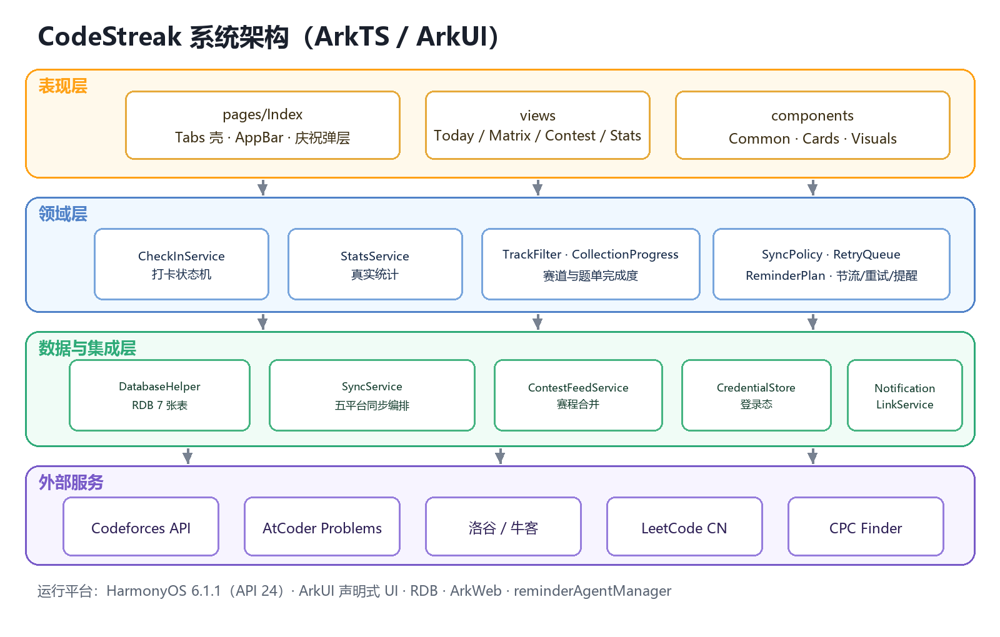
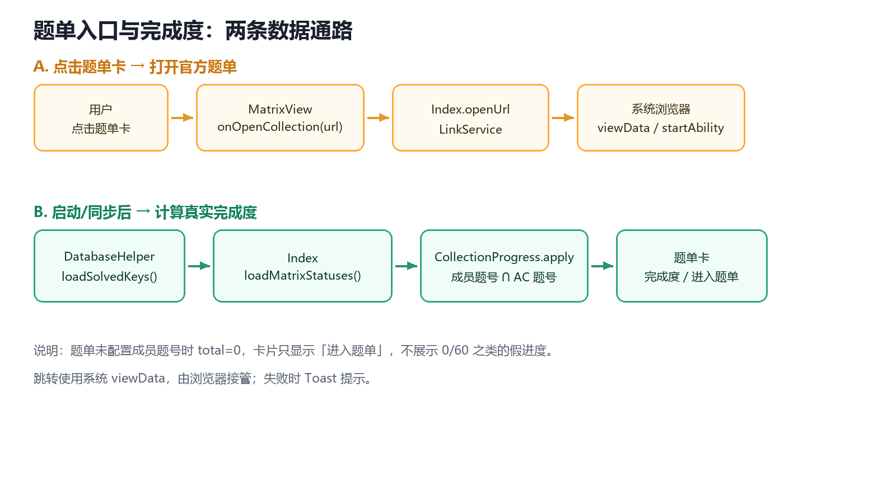
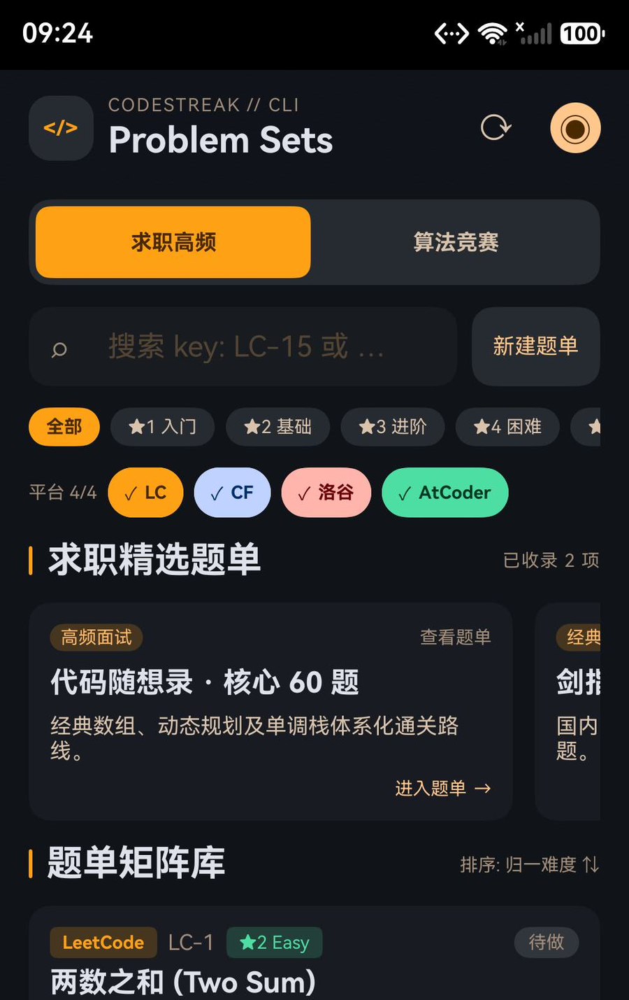
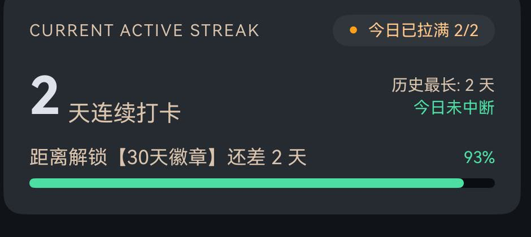
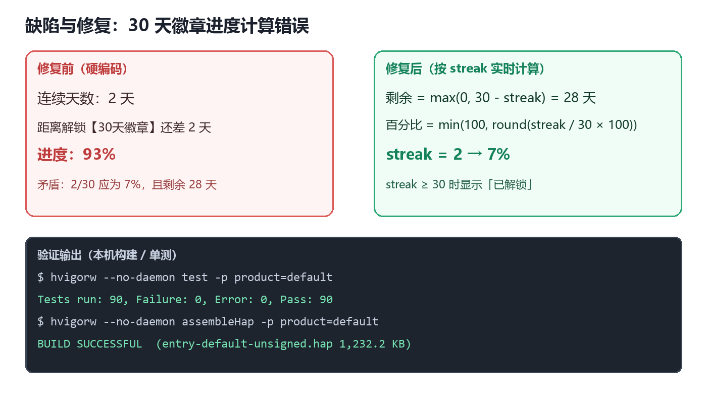

# AI 鸿蒙应用开发实训个人报告

**应用名称：CodeStreak —— 跨平台刷题打卡与赛训助手**

班级：____________    姓名：____________
学号：____________    小组：个人
日期：2026 年 10 月 27 日
开发环境：DevEco Studio（HarmonyOS SDK 6.1.1 / API 24，target 26）· 模拟器 127.0.0.1:5555

> 提交前请将班级、姓名、学号替换为真实信息，并按“姓名+班级+学号”重命名文件。

---

## 一、实训背景与任务

本次实训以“AI + HarmonyOS 应用开发”为主线，学习了 ArkTS 语法、ArkUI 声明式界面、@ComponentV2 状态管理、RDB、ArkWeb 与代理提醒，并使用 AI 辅助拆解需求、生成骨架、定位编译错误与补充测试。

我选择“跨平台刷题打卡”作为项目：刷题分散在 Codeforces、AtCoder、洛谷、牛客、LeetCode 五个平台，打卡靠自觉、赛程分散、进度没有统一口径。CodeStreak 试图把“今天做了几题、连续多少天、下一场比赛什么时候”收敛到一个本地优先的应用里。

项目已完成今日打卡、题单矩阵、比赛日历、统计榜单四个一级页面，以及 RDB 持久化、五平台同步与重试、WebView 登录、真实赛程与每日提醒；本次自测 90 条单测全通过、行覆盖率 87.71%。本人承担需求拆解、数据模型、四页 UI、同步适配、测试与发布准备。



*图1  CodeStreak 系统架构（表现层 / 领域层 / 数据与集成层 / 外部服务）*

## 二、功能实现与证据

### 2.1 功能实现：题单矩阵的真实入口与真实完成度

入口：底部 Tab「题单矩阵」→ 赛道分段（求职高频 / 算法竞赛）→ 官方精选题单横向卡。预期：点整卡打开官方题单；启动或同步后按“本地已 AC 题号 ∩ 成员题号”显示完成度；没有成员清单时只显示「进入题单」，不出现 0/60 的假进度。关键文件：MatrixView.ets、CollectionProgress.ets、Index.ets、LinkService.ets、SeedData.ets。核心计算摘录如下：

```ts
static apply(items: CollectionCard[], solvedKeys: string[]): CollectionCard[] {
  const solved: Set<string> = new Set<string>(solvedKeys);
  const result: CollectionCard[] = [];
  for (const item of items) {
    let done: number = 0;
    for (const key of item.problemKeys) {
      if (solved.has(key)) { done = done + 1; }
    }
    const total: number = item.problemKeys.length;
    const percent: number = total === 0 ? 0 : Math.round(done * 100 / total);
    const updated: CollectionCard = {
      id: item.id, tag: item.tag, title: item.title, desc: item.desc,
      done: done, total: total, percent: percent,
      track: item.track, url: item.url, problemKeys: item.problemKeys
    };
    result.push(updated);
  }
  return result;
}
```

三处与功能直接相关：① for (const key of item.problemKeys) 把成员题号与本地 AC 求交集，done 只统计真正做过的题；② total === 0 ? 0 : ... 保证无成员清单时不产生虚假百分比；③ MatrixView 的 .onClick(() => this.onOpenCollection(item.url)) 把 url 交给 Index.openUrl，再经 LinkService 以 ohos.want.action.viewData 拉起系统浏览器。



*图2  题单入口与完成度：跳转与计算两条数据通路*

### 2.2 AI 辅助：从需求到可验证的实现

真实 Prompt：“题单应该也能正确跳转至网页，请你继续修改，同时希望可以反应题单做了多少题，如果不行就算了。” AI 的关键回答：补官方 url 并用 LinkService 打开；新增 CollectionProgress 求交集；无成员清单不造 0/60；补 3 条单测。

我的取舍：接受上述方案；拒绝编造成员清单（会把演示数据当真实进度），也未改成内嵌 WebView（外链交系统浏览器更省权限）。生成代码逐段核对并补了测试。

### 2.3 功能验证

验证环境为 HarmonyOS 模拟器（1008×2232）。图3 是题单矩阵真机截图：求职高频下显示 2 个题单，切到算法竞赛后只剩 CF 1200–1400 突破营，题目列表也从 LC 题切换为 CF/洛谷题，说明赛道过滤同时作用于题单与题库；卡片右下角显示「进入题单」。点击“代码随想录”卡片后系统浏览器被拉到前台并显示加载页（模拟器网络受限，页面未加载完成），说明 url 已通过 LinkService 正确下发，返回应用后未崩溃。



*图3  题单矩阵真机截图（赛道分离、题单入口与筛选）*

## 三、问题排查与修复

问题现象：统计榜单页在“连续 2 天”的情况下，30 天徽章提示“还差 2 天 / 93%”，进度条几乎满格；按 2/30 应为 7%、还差 28 天（图4）。

定位：确认 streak = 2（首页与统计页一致），排除 RDB 与 StatsService；查看 components/Cards.ets 的 hud 分支，发现文案、93% 与进度条 93.3 都是硬编码。原因是首版为还原设计稿写死了展示值。

修复：剩余 = max(0, 30 - streak)，百分比 = min(100, round(streak / 30 × 100))，streak ≥ 30 时显示“已解锁【30天徽章】”。修复后重新构建并跑全量单测（90 条全通过），计算结果与预期一致（图5）；当前环境没有签名证书、无法重新安装，UI 复测需下次装包完成。

| 序号 | 操作步骤 | 预期结果 | 实际结果 | 是否通过 |
| --- | --- | --- | --- | --- |
| 1 | 题单矩阵：求职高频 → 算法竞赛 | 题单卡与题目列表同时切换 | 与预期一致，题单 2→1、题目变为 CF/洛谷 | 通过 |
| 2 | 点击“代码随想录”题单卡 | 打开代码随想录官网 | 系统浏览器被拉起；模拟器网络受限未加载页面 | 通过（跳转链路） |
| 3 | 统计页：连续 2 天查看徽章进度 | 7%、还差 28 天 | 93%、还差 2 天（失败）→ 已改为公式计算并单测通过 | 失败→已修复，待复测 |



*图4  缺陷现象：连续 2 天却显示“还差 2 天 / 93%”（真机）*



*图5  修复后的计算逻辑与构建/单测验证输出*

## 四、学习收获与后续计划

最大收获不是“写完四个页面”，而是三条工程习惯：先定数据口径再写 UI（连续天数、总 AC、题单完成度必须来自本地记录）；理解 @Builder 值参数与 ForEach 子项的更新边界，必要时改显式节点绑定；每完成一项就补测试、跑构建、更新文档并提交。

不足：签名与提审未完成；洛谷、牛客、LC 的登录与导入未逐平台真机回归；Cookie 仍明文存储；通知送达未实测。

后续计划（可检查）：第 1 周把 Cookie 迁入 Asset Store；第 2 周完成四平台登录/导入回归与 UI 冒烟，单测补到 110 条；第 3 周配置签名、产出可安装包并按 07-04 清单逐项打勾后提审。检查标准：四平台同步截图、通知录屏、签名包安装成功、G3 通过。

## AI 使用声明与事实说明

本报告使用的 AI 工具为 DeepSeek Harness（deepseek-flash 模型），用于需求拆解、ArkTS 代码生成与重构建议、编译错误定位、单测补充与文档整理。所有代码均在本地编译（BUILD SUCCESSFUL）、单测（90/90）与模拟器上运行；页面截图为模拟器实拍。

应用本身不包含云端 AI 功能，也不会上传用户的打卡与提交记录；报告中的班级、姓名、学号为待填占位，提交前需替换为真实信息。
