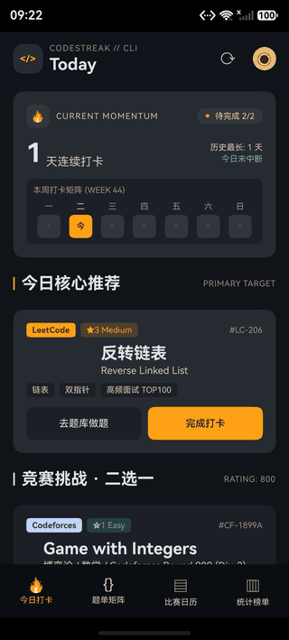

# CodeStreak 功能速览

> 把跨平台刷题变成一条不断裂的连胜。
> 面向算法竞赛选手与求职面试者的 HarmonyOS 跨平台刷题打卡与赛训助手。

## 1. 解决什么问题

刷题记录分散在 Codeforces、AtCoder、洛谷、牛客、LeetCode 五个平台；打卡靠自觉、赛程靠切换多个网站、进度没有统一口径。CodeStreak 把“今天做了几题、连续多少天、下一场比赛什么时候”收敛到一个**本地优先**的应用里。

## 2. 四个核心功能

| 功能 | 作用 |
| --- | --- |
| 今日打卡 | 每天 2 道目标题（目标卡 + 竞赛挑战），完成后连胜 +1；周矩阵、历史最长、庆祝反馈，离线也能打卡 |
| 题单矩阵 | 求职 / 竞赛双赛道分开刷；难度、平台多选筛选；题单卡直达官方页 |
| 比赛日历 | ICPC/CCPC + Codeforces + AtCoder 真实赛程，按时间排序，一键跳报名/榜单 |
| 统计榜单 | 连续天数、累计 AC、16 周热力图、难度分布、徽章；全部按本地记录计算 |

## 3. 差异化

- **真实数据**：没有演示数字。今日 AC、热力图、难度分布、题单进度都来自本地 RDB；没有数据就展示空态，不用 0/60 或 93% 的假进度。
- **五平台同步**：Codeforces / AtCoder 走公开 API，洛谷 / 牛客 / LeetCode 走内置 WebView 登录 + 导入；请求节流、失败按 1/5/15 分钟退避重试。
- **本地优先**：打卡、提交、设置都存在本机，不依赖自建服务端；卸载即清除。
- **可交付**：90 条单元测试、87.7% 行覆盖、分层图标、隐私与权限说明、发布前自测报告，代码以 MIT 协议开源。

## 4. 适合谁

- 准备 ICPC/CCPC、Codeforces、AtCoder 的竞赛选手；
- 正在准备算法面试、需要稳定刷题节奏的求职者；
- 想用“连续天数”对抗拖延、希望跨平台统一记录的自学者。

## 5. 演示与链接

- 两页介绍 PPT：[CodeStreak-功能速览.pptx](CodeStreak-功能速览.pptx)（无封面，直接讲功能与作用）
- 真实操作动图：`assets/codestreak-demo.gif`（打卡 → 切赛道 → 平台筛选 → 看赛程）
- 开源仓库：<https://github.com/acm910/codestreak>
- 设计与实现文档：见仓库 `docs/`
